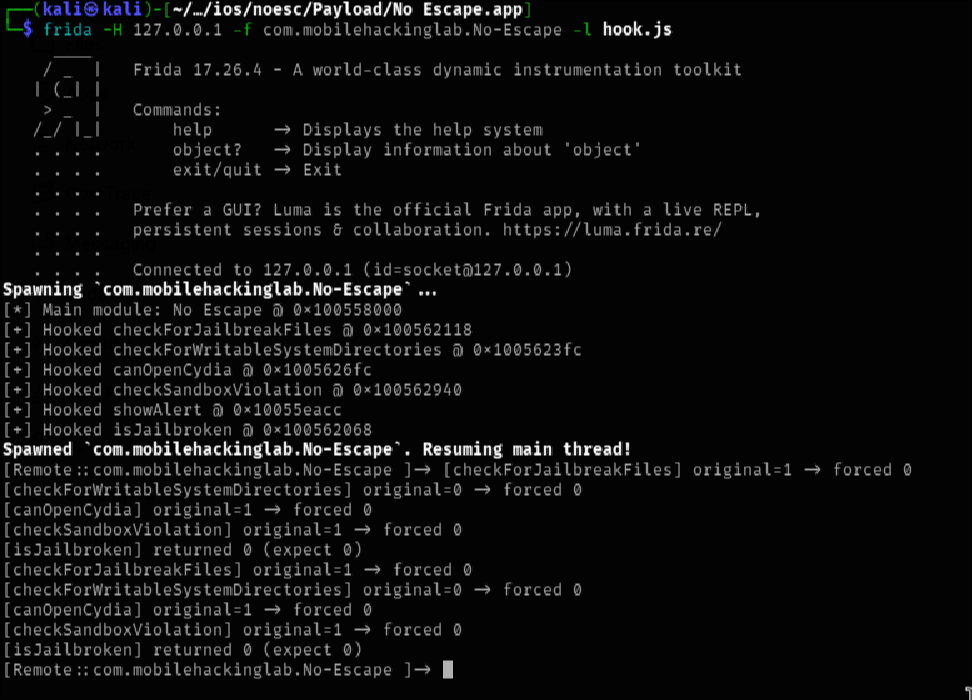
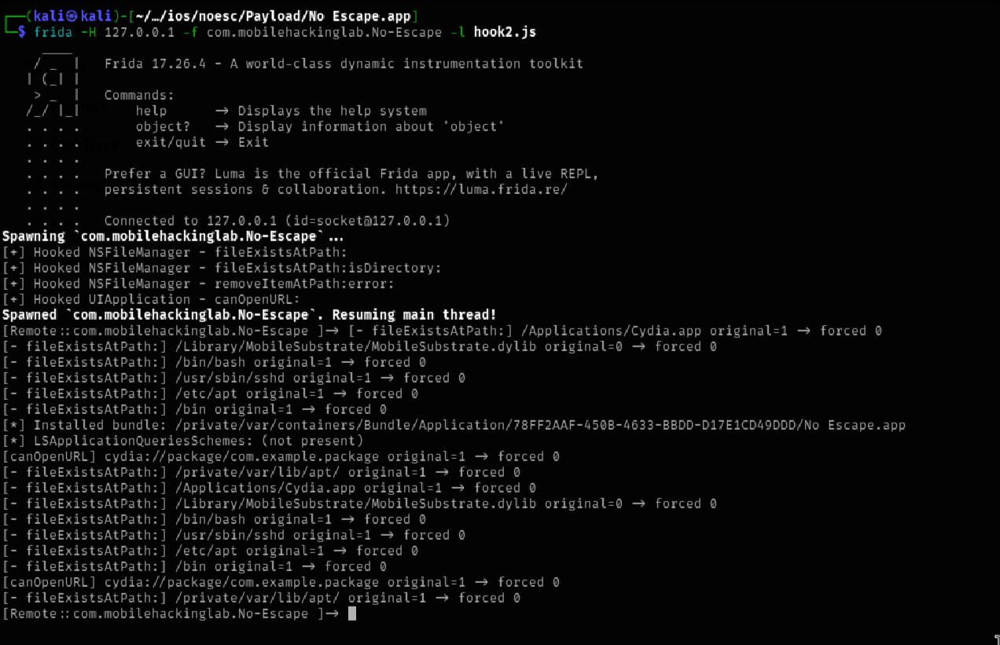
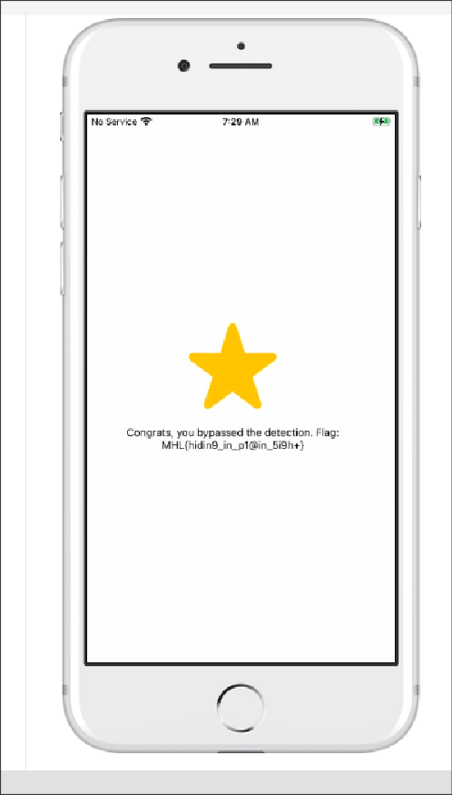

## Overview

**No Escape** is an iOS challenge from Mobile Hacking Lab. The app checks whether the device is jailbroken at launch, and if it is, it shows an alert and quits. The goal is to bypass that detection with Frida and reach the flag.

I solved it twice:

- **Option B:** hook the app's own four detection functions.
- **Option C:** hook the system APIs those functions call (`NSFileManager`, `UIApplication`), without touching any app symbols.

Along the way I made predictions from static analysis and checked each one at runtime. Some held, and two were wrong in interesting ways, so I've included those as well.

## Recon

The bundle is a single Swift executable with CryptoSwift linked in:

```text
$ plistutil -i Info.plist
CFBundleIdentifier   com.mobilehackinglab.No-Escape
MinimumOSVersion     15.4
DTPlatformVersion    17.5
...

$ find . -type f -exec file {} \; | grep Mach-O
./No Escape: Mach-O 64-bit arm64 executable, flags:<NOUNDEFS|DYLDLINK|TWOLEVEL|BINDS_TO_WEAK|PIE>

$ rabin2 -OC "No Escape"
<key>get-task-allow</key>
<true/>
```

Two things to note:

- **There is no `LSApplicationQueriesSchemes` key in Info.plist.** This becomes relevant later.
- **The binary is not stripped.** Most of the symbol table is CryptoSwift, but the app's own Swift functions are all there by name.

## Static analysis (Ghidra)

### The entry point

The check runs in `AppDelegate.application(_:didFinishLaunchingWithOptions:)`:

```c
_$s9No_Escape12isJailbrokenSbyF();
if ((param_1 & 1) != 0) {
    _$sSS21_builtinStringLiteral...(
        "Your device is jailbroken. This may compromise security. Quitting...", 0x44, 1);
    _$s9No_Escape11AppDelegateC9showAlert...();
}
return 1;
```

Because it runs during app launch, attaching Frida to a running process is too late. The app has to be **spawned** with the hooks already in place.

### A Ghidra trap: the phantom `param_1`

At first glance, the code above calls `isJailbroken()`, ignores the result, and then tests a parameter. It doesn't. Ghidra typed `isJailbroken` as returning nothing. On arm64, a Swift `Bool` comes back in `x0`, which is also the register for the first argument, so Ghidra shows the return value as `param_1`.

`isJailbroken` itself has the same artifact repeated four times:

```c
bool _$s9No_Escape12isJailbrokenSbyF(ulong param_1)
{
  checkForJailbreakFiles();
  local_14 = (uint)param_1;
  if ((param_1 & 1) == 0) {
    checkForWritableSystemDirectories();
  } else {
    local_14 = 1;
  }
  ...
}
```

If you change each callee's signature to return `bool` and re-decompile, the function collapses into a short-circuit OR:

```swift
return checkForJailbreakFiles()
    || checkForWritableSystemDirectories()
    || canOpenCydia()
    || checkSandboxViolation()
```

### The four checks

| Check | What it does |
|---|---|
| `checkForJailbreakFiles` | `fileExistsAtPath:` on `/Applications/Cydia.app`, `/Library/MobileSubstrate/MobileSubstrate.dylib`, `/bin/bash`, `/usr/sbin/sshd`, `/etc/apt`, `/bin` |
| `checkForWritableSystemDirectories` | Writes `"This is a test."` to `/private/jailbreak_test.txt`, then calls `removeItemAtPath:error:` on it |
| `canOpenCydia` | `UIApplication.canOpenURL:` on `cydia://package/com.example.package` |
| `checkSandboxViolation` | `fileExistsAtPath:` on `/private/var/lib/apt/` (despite the name, just another file check) |

### Predictions before running anything

- **`canOpenCydia`:** should always return false. Since iOS 9, `canOpenURL:` returns false for schemes not declared in `LSApplicationQueriesSchemes`, and Info.plist declares none.
- **`checkForWritableSystemDirectories`:** decided by whether the delete succeeds.
- **The rest:** depend on the jailbreak.

## Option B: hooking the app's detection functions

The four checks are private Swift functions, so they aren't exports. `Module.findExportByName` won't find them, but they are still in the symbol table. The script enumerates the main module's symbols, attaches to each check, **logs the original return value**, and then forces it to `0`.

Forcing every check to false matters for more than the bypass. With a short-circuit OR, plain logging only shows the checks up to the first one that returns true. Forcing each to false lets every check run, so all four results end up in the log.

```javascript
const CHECKS = [
  "checkForJailbreakFiles",
  "checkForWritableSystemDirectories",
  "canOpenCydia",
  "checkSandboxViolation",
];

const mod = Process.mainModule || Process.enumerateModules()[0];
const hooked = new Set();

function hook(addr, label, onLeaveFn) {
  if (hooked.has(addr.toString())) return;
  hooked.add(addr.toString());
  Interceptor.attach(addr, { onLeave: onLeaveFn });
  console.log(`[+] Hooked ${label} @ ${addr}`);
}

mod.enumerateSymbols().forEach((sym) => {
  const name = sym.name;
  if (!name.includes("No_Escape")) return;

  // "() -> Bool" mangles to ...SbyF; this skips descriptors and metadata
  for (const check of CHECKS) {
    if (name.includes(check) && name.endsWith("SbyF")) {
      hook(sym.address, check, function (retval) {
        const original = retval.toInt32() & 1;   // Swift Bool = low bit of x0
        console.log(`[${check}] original=${original} -> forced 0`);
        retval.replace(ptr(0));
      });
    }
  }

  if (name.includes("12isJailbrokenSbyF")) {
    hook(sym.address, "isJailbroken", (retval) =>
      console.log(`[isJailbroken] returned ${retval.toInt32() & 1} (expect 0)`));
  }

  // function symbol ends in "tF"; the "...tFTq" method descriptor does not
  if (name.includes("showAlert") && name.endsWith("tF")) {
    hook(sym.address, "showAlert", () =>
      console.log("[!] showAlert fired - bypass incomplete"));
  }
});
```

The full script, with extra logging and a fallback when no symbols match, is [`hook.js`](/assets/files/mhl-no-escape/hook.js).

```text
frida -H 127.0.0.1 -f com.mobilehackinglab.No-Escape -l hook.js
```

(The MHL lab device is reached over a forwarded frida-server, so the flag is `-H 127.0.0.1`, not `-U`.)




### What the results show

| Check | Predicted | Actual |
|---|---|---|
| `checkForJailbreakFiles` | true (Cydia is installed) | **1** |
| `checkForWritableSystemDirectories` | depends on sandbox | **0** |
| `canOpenCydia` | 0 (no queries schemes) | **1**, prediction wrong |
| `checkSandboxViolation` | true on a rootful jailbreak | **1** |

Without the hooks, three of the four checks would have flagged this device on their own.

**`isJailbroken` ran twice:** once for the alert in `AppDelegate` and once for the code that decides whether to show the flag. If I had only patched the branch in `AppDelegate`, the "Quitting..." alert would have gone away but the flag would still be hidden. Hooking the functions themselves covers every caller.

## Option C: hooking the system APIs

Option B depends on the app's symbols. Real apps are usually stripped, so the more reusable technique is to hook the APIs the checks are built on and lie only about jailbreak-related arguments:

- `-[NSFileManager fileExistsAtPath:]` and `fileExistsAtPath:isDirectory:`
- `-[NSFileManager removeItemAtPath:error:]`
- `-[UIApplication canOpenURL:]`

The filtering matters. These APIs are called constantly, and spoofing every call would break the app's normal file access. The script only lies about known jailbreak paths and URL schemes, and it logs every `canOpenURL:` call with its real result.

I also used this run to answer the `canOpenCydia` question, by printing the Info.plist the **installed** app is actually running with.

```javascript
const JB_PATHS = [
  "/Applications/Cydia.app", "/Library/MobileSubstrate", "/bin",
  "/usr/sbin/sshd", "/etc/apt", "/private/var/lib/apt",
  "/private/jailbreak_test.txt", "/var/jb",
];
const JB_SCHEMES = ["cydia", "sileo", "zbra", "filza", "undecimus"];

const isJbPath = (p) =>
  p !== null && JB_PATHS.some((jb) => p === jb || p.startsWith(jb + "/"));
const nsString = (p) => (p.isNull() ? null : new ObjC.Object(p).toString());

// Deferred: calling into Foundation at spawn time can kill the process
let diagDone = false;
function logInfoPlist() {
  if (diagDone) return;
  diagDone = true;
  const bundle = ObjC.classes.NSBundle.mainBundle();
  const schemes = bundle.infoDictionary().objectForKey_("LSApplicationQueriesSchemes");
  console.log(`[*] Installed bundle: ${bundle.bundlePath()}`);
  console.log(`[*] LSApplicationQueriesSchemes: ${schemes === null ? "(not present)" : schemes}`);
}

function hookBoolMethod(cls, sel, getTag, shouldSpoof) {
  Interceptor.attach(ObjC.classes[cls][sel].implementation, {
    onEnter(args) {
      this.tag = getTag(args);
      this.spoof = shouldSpoof(this.tag);
    },
    onLeave(retval) {
      if (!this.spoof) return;
      console.log(`[${sel}] ${this.tag} original=${retval.toInt32() & 1} -> forced 0`);
      retval.replace(ptr(0));
    },
  });
}

hookBoolMethod("NSFileManager", "- fileExistsAtPath:", (a) => nsString(a[2]), isJbPath);
hookBoolMethod("NSFileManager", "- fileExistsAtPath:isDirectory:", (a) => nsString(a[2]), isJbPath);
hookBoolMethod("NSFileManager", "- removeItemAtPath:error:", (a) => nsString(a[2]), isJbPath);

Interceptor.attach(ObjC.classes.UIApplication["- canOpenURL:"].implementation, {
  onEnter(args) {
    logInfoPlist();
    const url = new ObjC.Object(args[2]);
    this.url = url.absoluteString().toString();
    const scheme = url.scheme();
    this.spoof = scheme !== null && JB_SCHEMES.includes(scheme.toString().toLowerCase());
  },
  onLeave(retval) {
    const original = retval.toInt32() & 1;
    if (this.spoof) {
      console.log(`[canOpenURL] ${this.url} original=${original} -> forced 0`);
      retval.replace(ptr(0));
    } else {
      console.log(`[canOpenURL] ${this.url} -> ${original} (not spoofed)`);
    }
  },
});
```

The full script, with existence checks around each hook, is [`hook_c.js`](/assets/files/mhl-no-escape/hook_c.js):

```text
frida -H 127.0.0.1 -f com.mobilehackinglab.No-Escape -l hook_c.js
```

> **A gotcha I hit:** my first version read Info.plist at the top level of the script. With `-f`, the script loads while the app is still suspended at the very start of launch. Calling into Foundation that early made Frida fail with `Failed to load script: the connection is closed` before the app even spawned. Moving the lookup into the first `canOpenURL:` call, when the app is fully up, fixed it.





### What option C revealed

**1. `canOpenCydia` returned 1 even without the query schemes.** The installed bundle confirms there is no `LSApplicationQueriesSchemes`, so the lab didn't modify the app after I extracted the IPA. Yet `canOpenURL:` still returned 1 for `cydia://`. That leaves two explanations: the jailbreak environment is changing the result, or the iOS 9 restriction isn't being enforced on this device. Calling `canOpenURL:` on a scheme no app handles would tell them apart:
   - **It returns 1:** something is answering yes to everything.
   - **It returns 0:** the system is really checking for an installed handler and just ignoring the declaration requirement.

   Either way, the lesson is that a check I had called "dead" from reading the code was live on the real device.

**2. `removeItemAtPath:error:` was never called.** `/private/jailbreak_test.txt` is in the path list, so any call to the delete would have been logged, and none was. In reality the check works like this:

   ```swift
   do {
       try "This is a test.".write(toFile: path, atomically: true, encoding: .utf8)
       try FileManager.default.removeItem(atPath: path)
       return true
   } catch {
       return false
   }
   ```

   The sandbox blocked the write, Swift jumped to the `catch`, and the delete never ran. Ghidra hid this because Swift returns thrown errors in register `x21`, which the decompiler doesn't model, so the decompile made it look as if the delete always runs.

**3. `MobileSubstrate.dylib` returned 0.** This device runs **Substitute**, not Cydia Substrate (`com.ex.substitute.settings` shows up in `frida-ps`). The app only checks for the Substrate path, so it misses a Substitute jailbreak.

**4. The whole sequence ran twice,** matching the two `isJailbroken` calls seen in option B.

## Takeaways

- **Fix function signatures in Ghidra before trusting a Swift decompile.** The phantom `param_1` and the missing `x21` error path both made the code look like it did something it didn't.
- **Check static predictions at runtime.** Logging the original return value before forcing it is what caught both of my wrong predictions.
- **Hook high-level when you can, low-level when you must.** Hooking the app's functions is precise and readable. Hooking the system APIs survives stripped binaries and transfers to other apps, but it needs filtering.
- **Short-circuit logic hides results.** Force each check to false if you want to see all of them.
- **Path-based checks age badly.** This app's list misses Substitute and rootless jailbreaks that live under `/var/jb`.

## Flag

```text
MHL{hidin9_in_p1@in_5i9h+}
```
